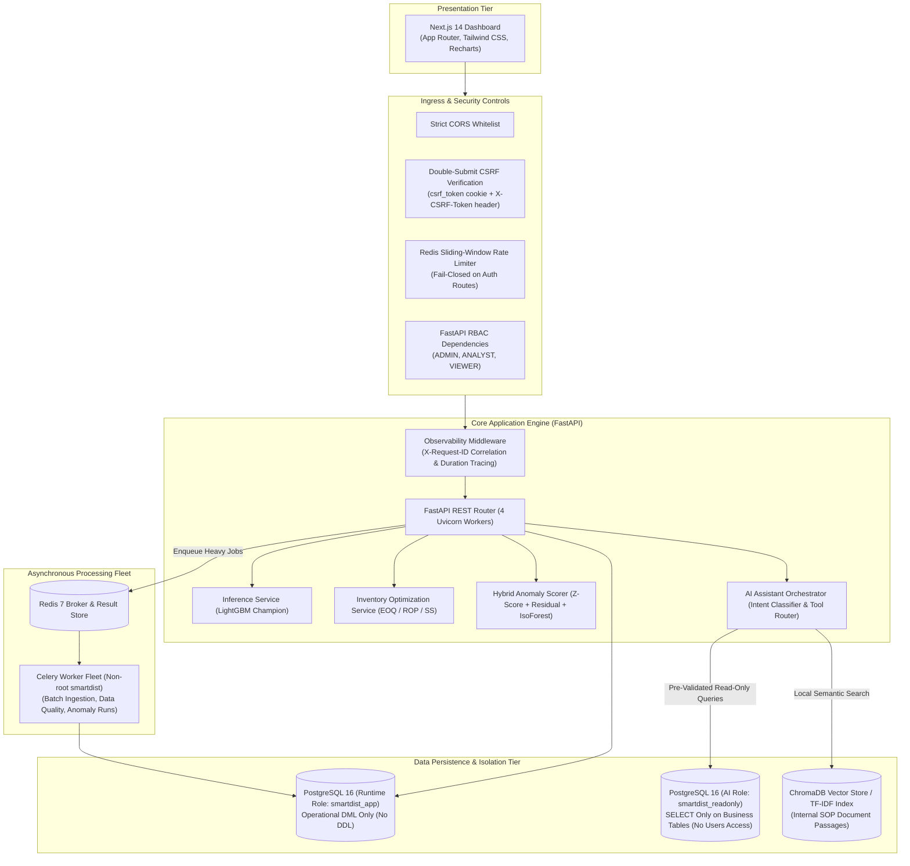

# SmartDist AI: Intelligent Distribution & Retail Management System

[](docs/audit/phase5-final-verification.md)
[](https://www.python.org/)
[](https://fastapi.tiangolo.com/)
[](https://nextjs.org/)
[](https://www.postgresql.org/)
[](https://redis.io/)
[](https://docs.celeryq.dev/)
[](https://www.docker.com/)
[](LICENSE)

An enterprise-grade, data-driven distribution and retail operations platform uniting machine learning demand forecasting, operations research inventory replenishment, multi-evidence anomaly detection, and a secure, offline-first conversational business assistant.

---

## Quick Navigation

- [1. Project Overview](#1-project-overview)
- [2. Key Features](#2-key-features)
- [3. Dashboard Preview](#3-dashboard-preview)
- [4. System Architecture](#4-system-architecture)
- [5. Technology Stack](#5-technology-stack)
- [6. Data Engineering & Provenance](#6-data-engineering--provenance)
- [7. Demand Forecasting](#7-demand-forecasting)
- [8. Inventory Optimization](#8-inventory-optimization)
- [9. Anomaly Detection](#9-anomaly-detection)
- [10. AI Business Assistant](#10-ai-business-assistant)
- [11. Security Architecture](#11-security-architecture)
- [12. Getting Started](#12-getting-started)
- [13. Testing & Verification](#13-testing--verification)
- [14. Repository Structure](#14-repository-structure)
- [15. Dataset Attribution & Academic Disclaimers](#15-dataset-attribution--academic-disclaimers)
- [16. License](#16-license)

---

## 1. Project Overview

Distribution networks and retail supply chains face an ongoing tension between service availability and capital efficiency. Inaccurate demand estimation triggers either costly excess stock (inflated holding costs and inventory spoilage) or critical stockouts (lost revenue, contractual penalties, and customer churn). Furthermore, operational anomalies such as sudden sales drops or uncharacteristic volume spikes often go unnoticed until standard financial closing cycles.

**SmartDist AI** addresses these operational challenges through a modular, reproducible platform that combines:
- **Data Engineering:** High-throughput batch ETL processing **648,648 historical daily sales records** across 54 retail branches and 33 product categories.
- **Machine Learning:** Multi-horizon demand forecasting (7-day, 14-day, and 30-day horizons) using gradient-boosted trees trained under chronological splits with zero lookahead leakage.
- **Operations Research:** Dynamic Safety Stock ($SS$), Reorder Point ($ROP$), and Economic Order Quantity ($EOQ$) calculations based on empirical lead-time and demand variance.
- **Anomaly Detection:** Multi-evidence hybrid scoring combining robust statistical metrics (MAD/Z-score), standardized forecast residuals, and unsupervised Isolation Forests.
- **AI Business Intelligence:** An offline-capable, deterministic decision assistant equipped with local vector search (ChromaDB), domain tool routing, and Safe Text-to-SQL constrained by PostgreSQL read-only role permissions.

> [!NOTE]
> This platform was engineered as an applied machine learning and backend systems portfolio project. It uses authentic historical daily sales records (store-family-date observations) from the public Corporation Favorita Kaggle competition combined with procedurally generated synthetic inventory and supplier baselines. It does not make exaggerated claims of unverified financial savings in live commercial environments.

---

## 2. Key Features

The platform provides six primary operational interfaces:

1. **Executive Overview (`/`)**:
   - Synthesizes top-level KPI metrics: estimated total revenue, active operational branches, pending inventory shortage alerts, and model forecast accuracy.
   - Displays aggregated 30-day historical revenue trends alongside a performance ranking table of regional branches.
2. **Sales Analytics (`/sales`)**:
   - Multi-dimensional sales analysis allowing operational managers to dissect historical daily sales observations and revenue by store cluster, city, and product family.
   - Filterable timeline visualizer tracking seasonal shifts, holiday impacts, and external economic signals (crude oil prices).
3. **Demand Forecasting (`/forecasting`)**:
   - Interactive forward-looking demand explorer for store-product pairs.
   - Visualizes recursive 7-day, 14-day, and 30-day predicted demand curves evaluated against out-of-sample holdout observations, coupled with operations research inventory replenishment calculations.
4. **Inventory Optimization (`/inventory`)**:
   - Stock health dashboard evaluating current on-hand warehouse inventory against dynamic $ROP$ and $SS$ boundaries.
   - Generates automated batch purchase order recommendations via $EOQ$ lot sizing and categorizes catalog items into an ABC-XYZ inventory matrix.
5. **Anomaly Detection (`/anomalies`)**:
   - Real-time and batch operational triage feed identifying irregular demand spikes, demand collapses, and zero-sales outages.
   - Explains detected anomalies via a multi-evidence inspector breaking down statistical Z-scores, forecast residuals, and Isolation Forest outlier contributions.
6. **AI Business Assistant (`/assistant`)**:
   - Conversational operations console providing natural language querying over sales analytics, inventory decisions, and Standard Operating Procedures (SOPs).
   - Generates and executes safe, sanitized read-only SQL queries with provenance attribution, and retrieves internal policy documentation via semantic search.

---

## 3. Dashboard Preview

The visual dashboard is built with Next.js 14 (App Router) and Tailwind CSS.

| Executive Overview | Demand Forecasting |
| :---: | :---: |
|  |  |
| *High-level revenue trends, shortage alerts & branch rankings* | *Multi-horizon predictions (7d/14d/30d) vs actual sales* |

| Inventory Optimization | AI Business Assistant |
| :---: | :---: |
|  |  |
| *Safety Stock, Dynamic ROP, EOQ & ABC-XYZ matrix* | *Safe Text-to-SQL, SOP citations & provenance badges* |

| Sales Analytics | Anomaly Detection |
| :---: | :---: |
|  |  |
| *Multi-dimensional sales volume & revenue analysis* | *Multi-evidence anomaly triage & severity badges* |

> *Note: Authentic 1440×1000 screenshots captured directly from the live application runtime. For a complete 5–7 minute technical interview walkthrough script, refer to the [Portfolio Demonstration Guide](docs/deployment/portfolio-demo-guide.md).*

---

## 4. System Architecture



### Component Boundaries & Communication:
- **Synchronous vs. Asynchronous:** Standard dashboard reads and single-product forecasts are served synchronously via FastAPI. Heavy data ingestion, data quality audits, and batch anomaly detection across 648,000 records are dispatched asynchronously to Celery workers via Redis.
- **Database Privilege Boundary:** The application runtime connects as `smartdist_app` (DML only, barred from DDL). The conversational SQL assistant is isolated to `smartdist_readonly` (strictly read-only transactions, zero write privileges, and denied access to authentication/user tables).
- **Offline AI Design:** The AI Assistant uses local deterministic routing, local ChromaDB embeddings, and rule-based synthesis. It makes zero calls to external paid LLM APIs at runtime.

---

## 5. Technology Stack

| Category | Component / Technology | Specification & Version |
| :--- | :--- | :--- |
| **Frontend** | Framework & Styling | Next.js 14.2 (App Router), React 18, TypeScript, Tailwind CSS 3.4 |
| | Visualizations & Icons | Recharts 2.12, Lucide React 0.359 |
| **Backend** | REST API Framework | FastAPI 0.115, Starlette, Uvicorn 0.34, Pydantic v2 |
| | ORM & Migrations | SQLAlchemy 2.0.38, Alembic 1.14 |
| **Data & Async** | Database Engine | PostgreSQL 16 Alpine (with least-privilege role separation) |
| | Cache & Session Store | Redis 7 Alpine, `redis-py` 5.2 |
| | Task Queue & Worker | Celery 5.4 (JSON task serialization, Redis broker/backend) |
| **Machine Learning**| Algorithms & Modeling | LightGBM 4.7.0, XGBoost 3.4.1, Scikit-Learn 1.9.1 |
| | Data Manipulation | Pandas 3.1.1, NumPy 2.5.4, PyArrow 19.0 |
| **AI & Retrieval** | Vector Store & NLP | ChromaDB 1.5.9 (local storage), Scikit-Learn TF-IDF, Regex NLP |
| **Security** | Hashing & Cryptography | Argon2id (`argon2-cffi` 23.1.0), PyJWT 2.10.1 (`HS256`) |
| **DevOps** | Containerization | Multi-stage non-root Docker (`smartdist:smartdist` & `nextjs:1001`) |
| **Testing** | Automated Verification | Pytest 9.2, `pytest-asyncio`, `httpx2`, ESLint 8.57 |

---

## 6. Data Engineering & Provenance

### Dataset Provenance
The historical daily sales core is sourced from the open academic dataset **Corporation Favorita Grocery Sales Forecasting** (Kaggle):
- **Temporal Span:** Full calendar year 2013 (`2013-01-01` to `2013-12-31`).
- **Scale:** **648,648** validated daily sales records (daily aggregated observations per store-product family).
- **Topology:** 54 physical retail stores across Ecuadorian provinces; 33 distinct product families.
- **Exogenous Signals:** Daily crude oil prices (Ecuadorian macroeconomic indicator) and national/regional holiday calendars.

### Feature Pipeline (Zero Temporal Leakage)
Engineered in `ml/features/` with strict backward-looking windows to prevent lookahead bias:
- **Calendar Signals:** Day of week, day of month, week of year, quarter, is_weekend, is_month_start, is_month_end.
- **Economic & Store Features:** Daily crude oil price, store type, store cluster, holiday flags (local, regional, national), promotion intensity.
- **Lag Features:** $t-1$, $t-7$, $t-14$, and $t-28$ days sales volume.
- **Rolling Window Statistics:** Rolling mean and rolling standard deviation over 7-day, 14-day, and 28-day windows.

### Synthetic Data Disclaimer
Parameters outside the Kaggle sales history—specifically warehouse inventory balances, supplier lead times, procurement costs ($S$), and unit holding costs ($H$)—were generated procedurally via `ml/pipelines/synthetic/inventory_generator.py` to establish an operational inventory simulation baseline. Fictional supplier names and warehouse topologies are explicitly synthetic and do not represent actual commercial operations.

---

## 7. Demand Forecasting

### Formulation & Objective
- **Target Variable:** `quantity_sold` (Daily sales units per store-product pair).
- **Validation Protocol:** Chronological time-series partition with strict temporal ordering:
  - **Train Set:** 2013-01-29 to 2013-10-31 (276 days)
  - **Validation Set:** 2013-11-01 to 2013-11-30 (30 days, 53,460 observations)
  - **Holdout Test Set:** 2013-12-01 to 2013-12-31 (31 days, 53,460 observations)

### Verified Model Comparison (Validation Set: November 2013)
*Source: [`ml/artifacts/*_metadata.json`](ml/artifacts/)*

| Model Architecture | MAE (Units) | RMSE | WAPE (%) | RMSLE | Status |
| :--- | :--- | :--- | :--- | :--- | :--- |
| **Seasonal Naive Baseline (Lag 7)** | 40.83 | 310.00 | 17.67% | 0.4103 | Baseline |
| **XGBoost Regressor (v1)** | 30.65 | 218.25 | 13.26% | 0.5434 | Challenger |
| **LightGBM Regressor (v1)** | **30.25** | **219.56** | **13.09%** | **0.5598** | **CHAMPION** |

### Multi-Horizon Holdout Evaluation (December 2013 Test Set)
Evaluated across holiday-dense December 2013 using recursive multi-horizon feature feeding:

| Forecast Horizon | Sample Count | Actual Mean Sales | MAE (Units) | RMSE | WAPE (%) | RMSLE |
| :--- | :--- | :--- | :--- | :--- | :--- | :--- |
| **7-Day Ahead** | 12,474 | 272.45 | **37.79** | 222.95 | **13.87%** | 0.6062 |
| **14-Day Ahead**| 24,948 | 266.19 | **44.52** | 244.10 | **16.72%** | 0.6712 |
| **30-Day Ahead**| 51,678 | 295.98 | **77.32** | 376.59 | **26.12%** | 1.0112 |

> *Generalization Note:* December represents a retail peak characterized by strong holiday seasonality. Error increases across longer horizons (30 days) due to recursive error compounding—an expected characteristic of autoregressive multi-step retail models.

---

## 8. Inventory Optimization

SmartDist AI converts forecasted demand distributions into mathematically grounded procurement decisions (`backend/app/services/`):

1. **Safety Stock ($SS$) under Stochastic Lead Time**:
   $$SS = Z \cdot \sqrt{L \cdot \sigma_D^2 + D^2 \cdot \sigma_L^2}$$
   Where $Z$ is the standard normal service level factor ($Z = 1.65$ for 95%, $Z = 2.05$ for 98%), $L$ is mean supplier lead time, $\sigma_D$ is demand variance, and $\sigma_L$ is lead-time variance.

2. **Dynamic Reorder Point ($ROP$)**:
   $$ROP = (\bar{D} \cdot L) + SS$$

3. **Economic Order Quantity ($EOQ$)**:
   $$EOQ = \sqrt{\frac{2 \cdot D \cdot S}{H}}$$
   Where $D$ is annual forecast demand, $S$ is fixed order cost per replenishment batch, and $H$ is unit holding cost per year.

4. **Days-of-Supply Runout & Monte Carlo Simulation**:
   - **Runout Days:** $\text{Runout} = I_{\text{on\_hand}} / \bar{D}_{\text{forecast}}$.
   - **Risk Tiers:** Flagged as `CRITICAL` when $\text{Runout} \le 0.5 \times L$ or stockout is imminent.
   - **Simulation Engine:** Evaluates empirical service levels over 1,000 iterations under stochastic demand draws (`simulation_service.py`).

---

## 9. Anomaly Detection

To prevent alert fatigue from single-algorithm thresholds, the system implements a **multi-evidence hybrid scoring engine** (`ml/anomaly_detection/`):

$$S_{\text{final}} = \sum_{i} w_i \cdot S_i \quad \text{where} \quad \sum w_i = 1.0$$

- **Statistical Robust Z-Score ($w = 0.40$):** Computes deviation using Median and Median Absolute Deviation (MAD), resilient against severe retail outliers.
- **Forecast Residual Score ($w = 0.35$):** Measures normalized divergence between actual sales volume and LightGBM predicted expectation.
- **Machine Learning Outlier Score ($w = 0.25$):** Unsupervised Scikit-Learn Isolation Forest trained on multivariate time-series sales features.
- **Calibrated Severity Tiers:**
  - `NORMAL`: $[0.00, 0.40)$
  - `LOW`: $[0.40, 0.60)$
  - `MEDIUM`: $[0.60, 0.75)$
  - `HIGH`: $[0.75, 0.90)$
  - `CRITICAL`: $[0.90, 1.00]$

> *Benchmark Note:* Anomaly precision and recall metrics were verified against programmatically injected synthetic benchmarks (`synthetic_benchmark.py`). Actual commercial detection rates depend on real-world operational definitions of shrinkage and data noise.

---

## 10. AI Business Assistant

The business assistant provides operational intelligence through an **offline-capable, zero-API-cost, deterministic architecture**:

- **Intent Classifier (`ai_assistant/orchestrator.py`):** Regex and semantic token classification mapping prompts to 6 internal tools (`sales_tool`, `forecast_tool`, `inventory_tool`, `anomaly_tool`, `rag_tool`, `sql_tool`).
- **Semantic SOP Retrieval (RAG):** Queries internal logistics and procurement policies using local ChromaDB vector embeddings with an automated TF-IDF fallback. Responses cite specific document filenames and section anchors.
- **Safe Text-to-SQL Engine:**
  - **Syntax Sanitizer (`sql_validator.py`):** Blocks comments (`--`, `/* */`), stacked queries (`;`), DDL/DML (`DROP`, `INSERT`, `UPDATE`), system functions (`version()`, `pg_shadow`), and recursive CTEs.
  - **PostgreSQL Privilege Boundary:** Queries execute under dedicated database role `smartdist_readonly` (`ReadOnlySessionLocal`). It has zero write privileges and is explicitly denied access to the `users` table.
- **Runtime Dependency Notice:** The assistant is completely self-contained within Python and local vector storage. It does **NOT** require an external LLM API key (e.g. OpenAI, Anthropic, Gemini) to operate.

---

## 11. Security Architecture

The platform enforces defense-in-depth across application, network, and data tiers:

- **Password Hashing:** Argon2id (`argon2-cffi`) using RFC 9106 recommended parameters ($m=64\text{MB}, t=3, p=4$).
- **Authentication & Sessions:** Stateless HS256 JWT tokens with 30-minute expiration. Logout actively registers token JTIs in a Redis expiration blocklist (`HTTP 401` on reused tokens).
- **Role-Based Access Control (RBAC):** Backend dependency enforcement:
  - `ADMIN`: Full access to user provisioning and system administration.
  - `ANALYST`: Access to analytics, forecasting, inventory, and AI Assistant.
  - `VIEWER`: Read-only access to dashboards (barred from assistant tools and user management).
- **CSRF & Origin Protection:** Double-submit cookie verification (`csrf_token` cookie matching `X-CSRF-Token` header on mutating requests) with Origin/Referer inspection against configured CORS whitelists.
- **Fail-Closed Rate Limiting:** Distributed Redis sliding-window limiter. Sensitive authentication routes fail closed (`HTTP 503`) if Redis is offline, preventing brute-force exploitation.
- **PostgreSQL Least Privilege:**
  - `smartdist_owner`: Migration and schema owner (`NOSUPERUSER NOCREATEDB NOCREATEROLE NOREPLICATION`).
  - `smartdist_app`: Operational application runtime (DML only, no DDL/DROP rights).
  - `smartdist_readonly`: AI Assistant engine (SELECT only, denied access to `users`).
- **Container Hardening:** Non-root execution (`USER smartdist` in backend, `USER nextjs` in frontend). Production compose binds database and cache strictly to internal container networks.

---

## 12. Getting Started

### Prerequisites
- **Docker Engine 24.0+** and **Docker Compose v2.20+**
- *(Alternative for native execution)*: Python 3.12+, Node.js 20 LTS, PostgreSQL 16, Redis 7

---

### Method A: Production Docker Deployment (Recommended)

1. **Clone the repository**:
   ```bash
   git clone https://github.com/your-username/smartdist-ai.git
   cd smartdist-ai
   ```

2. **Configure production environment**:
   ```bash
   cp .env.production.example .env.production
   ```
   *Edit `.env.production` and provide secure values for `SECRET_KEY`, `POSTGRES_OWNER_PASSWORD`, `POSTGRES_APP_PASSWORD`, `POSTGRES_READONLY_PASSWORD`, and `REDIS_PASSWORD`.*

3. **Launch the production container fleet**:
   ```bash
   PROD_ENV_FILE=.env.production docker compose -f docker-compose.prod.yml up -d --build
   ```

4. **Execute database migrations and provision least-privilege roles**:
   ```bash
   # Run schema migrations under owner role
   PROD_ENV_FILE=.env.production docker compose -f docker-compose.prod.yml run --rm backend \
       alembic upgrade head

   # Provision least-privilege roles
   docker exec -i smartdist_prod_postgres psql -U smartdist_owner -d smartdist_db < scripts/provision_db_roles.sql
   ```

5. **Access the application**:
   - Web Dashboard: **http://localhost:3000**
   - Backend OpenAPI Docs: **http://localhost:8000/api/v1/docs** (internal/dev only)
   - Default Administrator Seed:
     - **Username:** `admin`
     - **Password:** `Admin@SmartDist2026!` *(Configurable via `INITIAL_ADMIN_PASSWORD` in `.env.production`)*

---

### Method B: Local Native Development Setup

1. **Start database and cache services**:
   ```bash
   docker compose up -d postgres redis
   ```

2. **Configure local environment**:
   ```bash
   cp .env.example .env
   ```

3. **Setup and activate Python virtual environment**:
   ```bash
   python3 -m venv .venv
   source .venv/bin/activate
   pip install -r backend/requirements.txt
   ```

4. **Run migrations and start backend server**:
   ```bash
   alembic upgrade head
   python -m uvicorn backend.app.main:app --host 0.0.0.0 --port 8035 --reload
   ```

5. **Start frontend development server**:
   ```bash
   cd frontend
   npm install
   npm run dev
   ```
   Open **http://localhost:3000** in your browser.

---

### Health Checks
- Process Liveness Check: `curl -f http://localhost:8035/health`
- Deep Multi-Service Readiness Check (Postgres, Redis, Celery): `curl -f http://localhost:8035/api/v1/health`

---

## 13. Testing & Verification

SmartDist AI incorporates an extensive test suite verifying mathematical models, REST contracts, adversarial SQL security, Redis outages, and PostgreSQL privilege barriers:

```bash
# Execute all backend tests (253 tests)
PYTHONPATH=. .venv/bin/python -m pytest

# Execute frontend type checking, linting, and production build
cd frontend
npx tsc --noEmit
npm run lint
npm run build
```

**Verification Results:**
- **Backend Tests:** **253 passed out of 253** in 128.45s (0 failures, 0 errors).
- **Frontend Checks:** TypeScript (0 errors), ESLint (0 warnings), Next.js production build (10/10 static pages compiled cleanly).

---

## 14. Repository Structure

```text
smartdist-ai/
├── .dockerignore                            # Build context filter (24 MB context)
├── .env.example                             # Development configuration template
├── .env.production.example                  # Production least-privilege configuration template
├── .gitignore                               # Secret, backup, and dataset exclusion rules
├── LICENSE                                  # MIT Open Source License
├── README.md                                # Root technical portfolio presentation
├── docker-compose.yml                       # Local development compose (host port mapped)
├── docker-compose.prod.yml                  # Hardened production compose (internal network only)
├── ai_assistant/                            # Business Assistant Subsystem
│   ├── orchestrator.py                      # Intent classifier & multi-tool routing engine
│   ├── rag/                                 # ChromaDB semantic retrieval & TF-IDF fallback
│   ├── sql_agent/                           # Text-to-SQL agent, SQLValidator, SafeSQLExecutor
│   └── tools/                               # 6 Domain tools (sales, forecast, inventory, anomaly, rag, sql)
├── backend/                                 # Core Application Backend
│   ├── alembic/                             # Database schema migrations
│   ├── app/
│   │   ├── api/                             # FastAPI routers, dependencies (RBAC, JWT)
│   │   ├── core/                            # Config, security, rate_limit, csrf, logging, middleware
│   │   ├── db/                              # Sync & ReadOnly engines, session factories, init_db
│   │   ├── models/                          # SQLAlchemy ORM business & auth entities
│   │   ├── schemas/                         # Pydantic v2 validation contracts
│   │   ├── services/                        # EOQ, ROP, Safety Stock, Monte Carlo simulation, anomalies
│   │   └── workers/                         # Celery application & asynchronous worker tasks
│   └── tests/                               # 253 Automated backend test suites
├── docs/                                    # Documentation Tree
│   ├── README.md                            # Master documentation navigation index
│   ├── dataset-and-asset-licensing.md       # Intellectual property & data provenance guide
│   ├── architecture/                        # System topology & data flow diagrams
│   ├── machine-learning/                    # Feature engineering, model evaluation, validation strategy
│   ├── inventory/                           # Optimization formulas and stockout risk runout
│   ├── anomaly-detection/                   # Hybrid scoring methodology and synthetic benchmarks
│   ├── ai-assistant/                        # Tool integration, RAG, and SQL security
│   ├── security/                            # Authentication, database roles, security operations
│   ├── deployment/                          # Deployment SOP, backup/restore, monitoring runbooks
│   └── audit/                               # Preserved engineering audits (Phase 2 through 6.2)
├── frontend/                                # Next.js 14 Web Application
│   ├── src/app/                             # App Router pages (6 domain views + login)
│   ├── src/components/                      # Reusable UI widgets, charts, navigation
│   ├── src/lib/                             # Typed API client with CSRF token extraction
│   └── next.config.mjs                      # Security headers & Content Security Policy (CSP)
├── infrastructure/                          # Dockerfiles & Redis Configuration
│   ├── docker/                              # Non-root Dockerfile.backend & Dockerfile.frontend
│   └── redis/                               # Hardened redis.conf
├── ml/                                      # Machine Learning Engineering Subsystem
│   ├── anomaly_detection/                   # Multi-evidence hybrid scoring engine
│   ├── artifacts/                           # Serialized models (LightGBM, XGBoost, Naive, IsoForest)
│   ├── data/                                # Gitkept raw/processed/features directories
│   ├── features/                            # Lag, rolling, calendar, and external oil/holiday features
│   ├── inference/                           # Offline & online multi-horizon forecast predictors
│   ├── models/                              # LightGBM, XGBoost, SeasonalNaive wrappers
│   └── training/                            # Training pipelines, evaluators, model registry
├── screenshots/                             # Visual Documentation Assets
│   ├── README.md                            # Screenshot capture guide & privacy instructions
│   ├── dashboard/                           # Executive overview & sales analytics captures
│   ├── forecasting/                         # Demand forecasting captures
│   ├── inventory/                           # Inventory optimization captures
│   ├── anomalies/                           # Anomaly detection captures
│   └── assistant/                           # AI Business Assistant captures
└── scripts/                                 # Operational & Automation Scripts
    ├── backup_db.sh                         # PostgreSQL compressed backup with SHA256
    ├── restore_db.sh                        # Disaster recovery restore with overwrite safety guard
    └── provision_db_roles.sql               # PostgreSQL least-privilege role setup script
```

---

## 15. Dataset Attribution & Academic Disclaimers

- **Retail Sales History:** Corporation Favorita Grocery Sales Forecasting dataset hosted by Kaggle under public open license.
- **Academic Citation:**
  > Corporación Favorita. (2017). *Corporación Favorita Grocery Sales Forecasting*. Kaggle. https://www.kaggle.com/c/favorita-grocery-sales-forecasting
- **Synthetic Extensions:** Warehouse stock levels, replenishment constraints, supplier parameters, and synthetic anomaly benchmarks were generated procedurally for research and development purposes.
- **Redistribution Policy:** Raw CSV files are excluded from version control via `.gitignore`. Users wishing to retrain models from raw files should download the dataset directly from Kaggle.

---

## 16. License

This software is licensed under the **MIT License** — see the [LICENSE](LICENSE) file for details.
