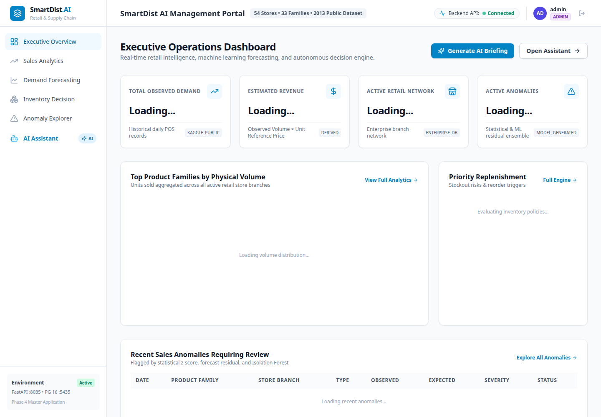
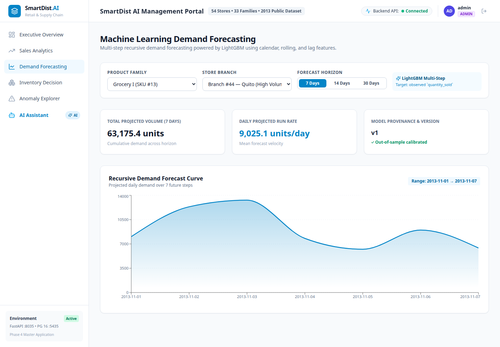
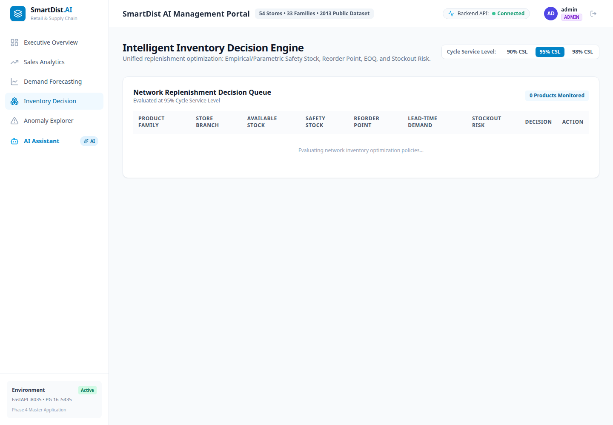
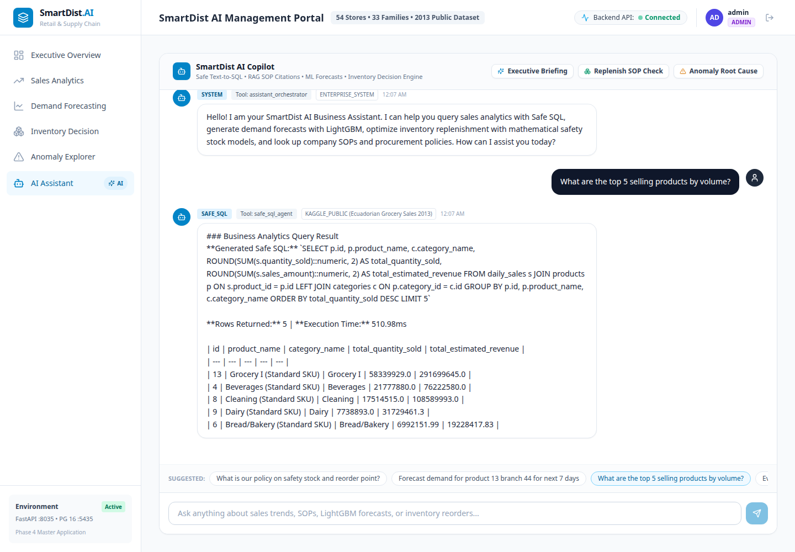
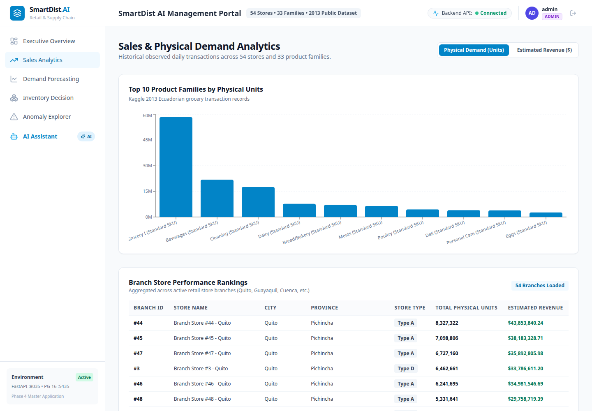
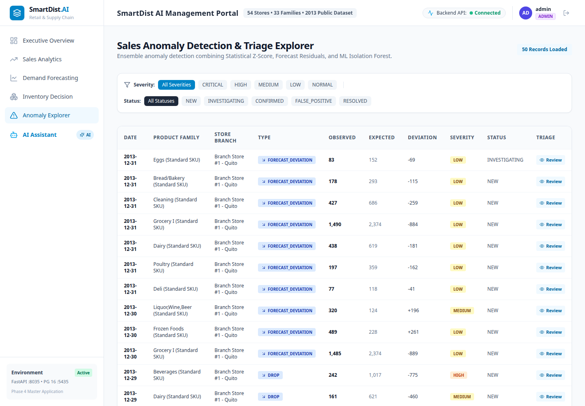
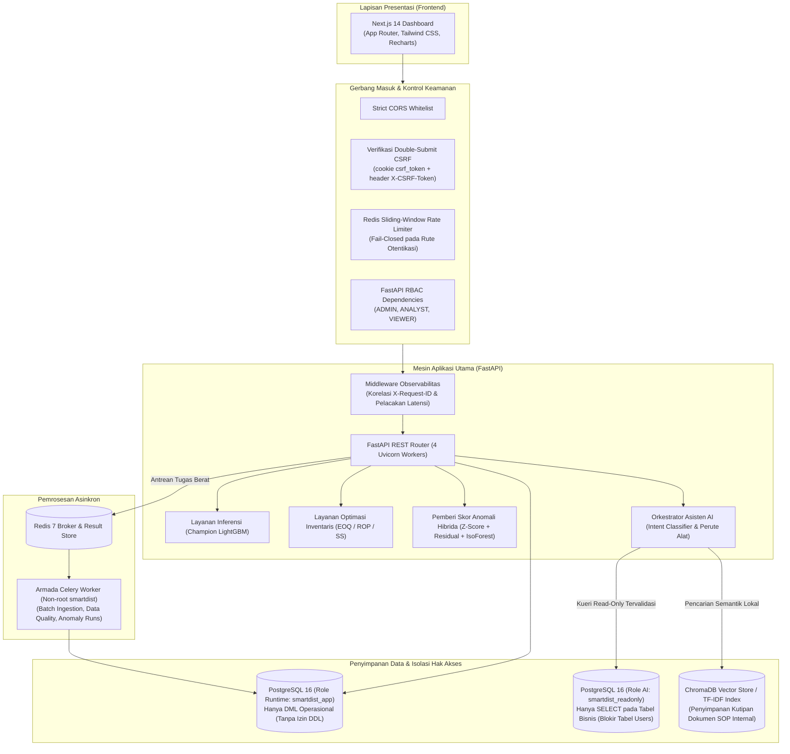

# SmartDist AI: Intelligent Distribution & Retail Management System

[](docs/audit/phase5-final-verification.md)
[](https://www.python.org/)
[](https://fastapi.tiangolo.com/)
[](https://nextjs.org/)
[](https://www.postgresql.org/)
[](https://redis.io/)
[](https://docs.celeryq.dev/)
[](https://www.docker.com/)
[](LICENSE)

Platform manajemen operasi distribusi dan ritel berskala *enterprise* berbasis data yang mengintegrasikan peramalan permintaan (*demand forecasting*) menggunakan *machine learning*, optimalisasi pengadaan inventaris berbasis riset operasi (*operations research*), deteksi anomali multi-indikator (*multi-evidence anomaly detection*), serta asisten bisnis interaktif deterministik yang aman dan bekerja secara *offline-first*.

---

## Navigasi Cepat

- [1. Ringkasan Proyek](#1-ringkasan-proyek)
- [2. Fitur Utama](#2-fitur-utama)
- [3. Tampilan Antarmuka (Dashboard)](#3-tampilan-antarmuka-dashboard)
- [4. Arsitektur Sistem](#4-arsitektur-sistem)
- [5. Stack Teknologi](#5-stack-teknologi)
- [6. Rekayasa Data & Provenansi](#6-rekayasa-data--provenansi)
- [7. Peramalan Permintaan (Demand Forecasting)](#7-peramalan-permintaan-demand-forecasting)
- [8. Optimalisasi Inventaris (Inventory Optimization)](#8-optimalisasi-inventaris-inventory-optimization)
- [9. Deteksi Anomali (Anomaly Detection)](#9-deteksi-anomali-anomaly-detection)
- [10. Asisten Bisnis AI (AI Business Assistant)](#10-asisten-bisnis-ai-ai-business-assistant)
- [11. Arsitektur Keamanan](#11-arsitektur-keamanan)
- [12. Panduan Instalasi & Menjalankan Aplikasi](#12-panduan-instalasi--menjalankan-aplikasi)
- [13. Pengujian & Verifikasi Kualitas](#13-pengujian--verifikasi-kualitas)
- [14. Struktur Direktori Repositori](#14-struktur-direktori-repositori)
- [15. Atribusi Dataset & Batasan Akademis](#15-atribusi-dataset--batasan-akademis)
- [16. Lisensi](#16-lisensi)

---

## 1. Ringkasan Proyek

Jaringan distribusi dan rantai pasok ritel terus menghadapi dilema operasional antara ketersediaan layanan (*service level*) dan efisiensi modal kerja. Estimasi permintaan yang tidak akurat dapat memicu penumpukan stok berlebih (*overstock*) yang meningkatkan biaya simpan serta risiko kerusakan barang, atau justru kelangkaan stok (*stockout*) yang menyebabkan hilangnya pendapatan potensial dan penurunan kepuasan pelanggan. Selain itu, anomali operasional seperti penurunan penjualan mendadak atau lonjakan volume yang mencurigakan kerap baru terdeteksi pada akhir periode tutup buku.

**SmartDist AI** menjawab tantangan operasional tersebut melalui platform modular yang siap direproduksi dengan menggabungkan:
- **Rekayasa Data (Data Engineering):** Pemrosesan batch ETL berkinerja tinggi atas **648.648 data historis observasi penjualan harian agregat** di 54 cabang toko dan 33 kategori famili produk.
- **Machine Learning:** Peramalan permintaan multi-horizon (horizon 7 hari, 14 hari, dan 30 hari) menggunakan algoritma *gradient-boosted trees* yang dilatih dengan partisi kronologis tanpa kebocoran data masa depan (*zero lookahead leakage*).
- **Riset Operasi (Operations Research):** Penentuan dinamis atas Safety Stock ($SS$), Reorder Point ($ROP$), dan Economic Order Quantity ($EOQ$) berdasarkan varians waktu tunggu (*lead time*) dan varians permintaan riil.
- **Deteksi Anomali:** Mesin penilaian hibrida multi-indikator yang menggabungkan statistik *robust* (MAD/Z-score), residual peramalan terstandarisasi, dan algoritma *unsupervised* Isolation Forest.
- **Business Intelligence & AI:** Asisten pengambil keputusan deterministik yang dapat berjalan *offline*, dilengkapi pencarian semantik vektor lokal (ChromaDB), perutean alat berbasis domain, serta eksekusi *Safe Text-to-SQL* yang dibatasi oleh hak akses read-only di level basis data PostgreSQL.

> [!NOTE]
> Proyek ini dikembangkan sebagai portofolio teknis rekayasa sistem *backend* dan *applied machine learning*. Proyek ini menggunakan data penjualan harian riil (observasi agregat toko-famili-tanggal) dari kompetisi publik Kaggle Corporation Favorita, yang dipadukan dengan baseline inventaris dan pemasok sintetis prosedural. Platform ini tidak membuat klaim penghematan finansial komersial yang tidak terverifikasi.

---

## 2. Fitur Utama

Aplikasi ini menyediakan enam antarmuka operasional utama:

1. **Executive Overview (`/`)**:
   - Menyajikan KPI operasional tingkat tinggi: estimasi total pendapatan, jumlah cabang aktif, peringatan kelangkaan stok (*shortage alerts*), dan akurasi model peramalan.
   - Menampilkan visualisasi tren pendapatan historis 30 hari serta tabel peringkat performa cabang regional.
2. **Sales Analytics (`/sales`)**:
   - Analisis penjualan multi-dimensi yang memungkinkan manajer operasional membedah observasi penjualan harian dan pendapatan berdasarkan kluster toko, kota, dan kategori famili produk.
   - Grafik interaktif untuk memantau pergeseran musiman, dampak hari libur, dan sinyal ekonomi eksternal (harga minyak mentah).
3. **Demand Forecasting (`/forecasting`)**:
   - Eksplorasi peramalan permintaan interaktif untuk setiap kombinasi toko dan produk.
   - Menampilkan kurva prediksi rekursif multi-horizon (7 hari, 14 hari, dan 30 hari) yang dievaluasi langsung terhadap data aktual *holdout*, lengkap dengan rekomendasi pengadaan inventaris berbasis riset operasi.
4. **Inventory Optimization (`/inventory`)**:
   - Dasbor kesehatan stok yang mengevaluasi inventaris fisik gudang (*on-hand inventory*) terhadap ambang batas dinamis $ROP$ dan $SS$.
   - Menghasilkan rekomendasi pesanan pembelian batch otomatis berbasis lot sizing $EOQ$ serta mengklasifikasikan katalog produk ke dalam matriks inventaris ABC-XYZ.
5. **Anomaly Detection (`/anomalies`)**:
   - Dasbor triase anomali operasional untuk mendeteksi lonjakan volume penjualan tidak wajar, anjloknya permintaan, atau indikasi kegagalan operasional (*zero-sales outage*).
   - Menyediakan inspektur multi-bukti yang merinci kontribusi nilai Z-score statistik, deviasi residual model, dan skor pencilan Isolation Forest.
6. **AI Business Assistant (`/assistant`)**:
   - Konsol interaktif bahasa alami untuk mengevaluasi analisis penjualan, rekomendasi inventaris, dan Standar Operasional Prosedur (SOP).
   - Menghasilkan dan mengeksekusi kueri SQL read-only yang aman dengan atribusi provenansi data, serta menemukan kutipan dokumen SOP internal melalui pencarian semantik.

---

## 3. Tampilan Antarmuka (Dashboard)

Antarmuka dasbor web dibangun menggunakan Next.js 14 (App Router) dan Tailwind CSS.

| Executive Overview | Demand Forecasting |
| :---: | :---: |
|  |  |
| *Tren pendapatan tingkat tinggi, peringatan kritis & ranking cabang* | *Prediksi multi-horizon (7h/14h/30h) vs data penjualan aktual* |

| Inventory Optimization | AI Business Assistant |
| :---: | :---: |
|  |  |
| *Safety Stock, Dynamic ROP, EOQ & Matriks Analisis ABC-XYZ* | *Safe Text-to-SQL, sitasi SOP & badge transparansi data* |

| Sales Analytics | Anomaly Detection |
| :---: | :---: |
|  |  |
| *Analisis multi-dimensi volume penjualan & pendapatan per cabang* | *Triase anomali multi-bukti & indikator tingkat keparahan* |

> *Catatan: Seluruh tangkapan layar di atas diambil secara langsung dari aplikasi yang sedang berjalan pada resolusi 1440×1000. Untuk panduan demonstrasi teknis berdurasi 5–7 menit, silakan merujuk ke [Portfolio Demonstration Guide](docs/deployment/portfolio-demo-guide.md).*

---

## 4. Arsitektur Sistem



### Batasan Komponen & Pola Komunikasi:
- **Sinkron vs. Asinkron:** Pembacaan data dasbor dan inferensi peramalan produk tunggal ditangani secara sinkron via FastAPI. Proses berat seperti *batch ingestion*, audit kualitas data, dan kalkulasi deteksi anomali pada 648.000+ data dialihkan secara asinkron ke Celery worker melalui Redis.
- **Isolasi Hak Akses Basis Data:** Aplikasi utama terhubung menggunakan role `smartdist_app` (hanya izin DML, dilarang menjalankan DDL). Asisten SQL terisolasi sepenuhnya pada role `smartdist_readonly` (transaksi read-only absolut, tanpa izin tulis, dan ditolak aksesnya ke tabel pengguna/kredensial).
- **Desain AI Offline-First:** Asisten AI menggunakan perutean deterministik lokal, embedding lokal ChromaDB, dan sintesis berbasis aturan terverifikasi. Sistem ini tidak memerlukan koneksi maupun biaya API LLM eksternal pihak ketiga saat berjalan.

---

## 5. Stack Teknologi

| Kategori | Komponen / Teknologi | Spesifikasi & Versi |
| :--- | :--- | :--- |
| **Frontend** | Framework & Tampilan | Next.js 14.2 (App Router), React 18, TypeScript, Tailwind CSS 3.4 |
| | Visualisasi & Ikon | Recharts 2.12, Lucide React 0.359 |
| **Backend** | Framework REST API | FastAPI 0.115, Starlette, Uvicorn 0.34, Pydantic v2 |
| | ORM & Migrasi DB | SQLAlchemy 2.0.38, Alembic 1.14 |
| **Data & Antrean** | Mesin Basis Data | PostgreSQL 16 Alpine (isolasi hak akses bertingkat) |
| | Cache & Sesi | Redis 7 Alpine, `redis-py` 5.2 |
| | Task Queue & Worker | Celery 5.4 (serialisasi JSON, broker/backend Redis) |
| **Machine Learning**| Algoritma & Model | LightGBM 4.7.0, XGBoost 3.4.1, Scikit-Learn 1.9.1 |
| | Manipulasi Data | Pandas 3.1.1, NumPy 2.5.4, PyArrow 19.0 |
| **AI & Retrieval** | Vector Store & NLP | ChromaDB 1.5.9 (penyimpanan lokal), Scikit-Learn TF-IDF, Regex NLP |
| **Keamanan** | Hashing & Kriptografi | Argon2id (`argon2-cffi` 23.1.0), PyJWT 2.10.1 (`HS256`) |
| **DevOps** | Kontainerisasi | Docker multi-stage non-root (`smartdist:smartdist` & `nextjs:1001`) |
| **Pengujian** | Verifikasi Otomatis | Pytest 9.2, `pytest-asyncio`, `httpx`, ESLint 8.57 |

---

## 6. Rekayasa Data & Provenansi

### Provenansi Dataset
Data historis observasi penjualan harian bersumber dari dataset riset terbuka **Corporation Favorita Grocery Sales Forecasting** (Kaggle):
- **Rentang Waktu:** Tahun kalender penuh 2013 (`2013-01-01` s.d. `2013-12-31`).
- **Skala Data:** **648.648** data observasi penjualan harian tervalidasi (agregat tingkat toko-famili produk per hari).
- **Cakupan Toko & Produk:** 54 toko ritel fisik di berbagai provinsi Ekuador; 33 famili kategori produk.
- **Sinyal Eksogen:** Harga harian minyak mentah dunia (indikator makroekonomi Ekuador) serta kalender hari libur nasional dan regional.

### Pipeline Fitur (Tanpa Kebocoran Data Masa Depan)
Dibangun pada direktori `ml/features/` dengan jendela waktu mundur (*backward-looking*) yang ketat guna mencegah *lookahead bias*:
- **Fitur Kalender:** Hari dalam seminggu, tanggal dalam bulan, minggu dalam tahun, kuartal, penanda akhir pekan, awal bulan, dan akhir bulan.
- **Fitur Toko & Ekonomi:** Harga minyak harian, tipe toko, kluster toko, penanda hari libur (lokal, regional, nasional), dan status promosi.
- **Fitur Lag:** Volume penjualan pada hari $t-1$, $t-7$, $t-14$, dan $t-28$.
- **Statistik Rolling Window:** Rata-rata bergerak (*rolling mean*) dan standar deviasi bergerak (*rolling std*) pada jendela 7 hari, 14 hari, dan 28 hari.

### Keterangan Data Sintetis
Parameter operasional di luar data penjualan Kaggle—khususnya saldo stok gudang, waktu tunggu pemasok (*lead time*), biaya pemesanan ($S$), dan biaya simpan per unit ($H$)—dibuat secara prosedural melalui skrip `ml/pipelines/synthetic/inventory_generator.py` untuk mensimulasikan lingkungan pengadaan logistik nyata. Nama pemasok dan konfigurasi gudang merupakan data sintetis simulasi dan tidak merepresentasikan entitas komersial tertentu.

---

## 7. Peramalan Permintaan (Demand Forecasting)

### Formulasi & Tujuan
- **Target Prediksi:** `quantity_sold` (Unit kuantitas penjualan harian per kombinasi cabang toko dan famili produk).
- **Protokol Validasi:** Pemisahan deret waktu kronologis (*chronological time-series split*):
  - **Data Latih (Train Set):** 2013-01-29 s.d. 2013-10-31 (276 hari)
  - **Data Validasi (Validation Set):** 2013-11-01 s.d. 2013-11-30 (30 hari, 53.460 observasi)
  - **Data Uji Holdout (Holdout Test Set):** 2013-12-01 s.d. 2013-12-31 (31 hari, 53.460 observasi)

### Perbandingan Model Tervalidasi (Data Validasi: November 2013)
*Sumber: [`ml/artifacts/*_metadata.json`](ml/artifacts/)*

| Arsitektur Model | MAE (Unit) | RMSE | WAPE (%) | RMSLE | Status |
| :--- | :--- | :--- | :--- | :--- | :--- |
| **Seasonal Naive Baseline (Lag 7)** | 40,83 | 310,00 | 17,67% | 0,4103 | Baseline |
| **XGBoost Regressor (v1)** | 30,65 | 218,25 | 13,26% | 0,5434 | Penantang |
| **LightGBM Regressor (v1)** | **30,25** | **219,56** | **13,09%** | **0,5598** | **CHAMPION** |

### Evaluasi Rekursif Multi-Horizon (Data Uji Desember 2013)
Dievaluasi pada periode lonjakan belanja liburan akhir tahun (Desember 2013) dengan pengisian fitur rekursif:

| Horizon Prediksi | Jumlah Sampel | Rata-rata Penjualan Riil | MAE (Unit) | RMSE | WAPE (%) | RMSLE |
| :--- | :--- | :--- | :--- | :--- | :--- | :--- |
| **7 Hari ke Depan** | 12.474 | 272,45 | **37,79** | 222,95 | **13,87%** | 0,6062 |
| **14 Hari ke Depan**| 24.948 | 266,19 | **44,52** | 244,10 | **16,72%** | 0,6712 |
| **30 Hari ke Depan**| 51.678 | 295,98 | **77,32** | 376,59 | **26,12%** | 1,0112 |

> *Catatan Generalisasi:* Periode Desember memiliki lonjakan volume penjualan ritel signifikan (+27,9% dibanding bulan reguler). Kenaikan galat prediksi pada horizon yang lebih panjang (30 hari) diakibatkan oleh akumulasi galat rekursif (*compounding error*), yang merupakan karakteristik alami dari peramalan autoregresif multi-langkah.

---

## 8. Optimalisasi Inventaris (Inventory Optimization)

SmartDist AI menerjemahkan distribusi peramalan permintaan menjadi keputusan pengadaan yang terukur secara matematis (`backend/app/services/`):

1. **Safety Stock ($SS$) dengan Waktu Tunggu Stokastik**:
   $$SS = Z \cdot \sqrt{L \cdot \sigma_D^2 + D^2 \cdot \sigma_L^2}$$
   Di mana $Z$ adalah faktor tingkat layanan normal standar ($Z = 1,65$ untuk 95%, $Z = 2,05$ untuk 98%), $L$ adalah rata-rata lead time pemasok, $\sigma_D$ adalah varians permintaan, dan $\sigma_L$ adalah varians lead time.

2. **Titik Pemesanan Kembali Dinamis (Dynamic Reorder Point / $ROP$)**:
   $$ROP = (\bar{D} \cdot L) + SS$$

3. **Kuantitas Pesanan Ekonomis (Economic Order Quantity / $EOQ$)**:
   $$EOQ = \sqrt{\frac{2 \cdot D \cdot S}{H}}$$
   Di mana $D$ adalah estimasi permintaan tahunan, $S$ adalah biaya pemesanan per batch, dan $H$ adalah biaya penyimpanan per unit per tahun.

4. **Ketahanan Stok (Days of Supply) & Simulasi Monte Carlo**:
   - **Estimasi Hari Habis:** $\text{Runout} = I_{\text{on\_hand}} / \bar{D}_{\text{forecast}}$.
   - **Tingkat Risiko:** Ditandai sebagai `CRITICAL` jika $\text{Runout} \le 0,5 \times L$ atau terjadi risiko *stockout* mendesak.
   - **Mesin Simulasi:** Menguji ketahanan tingkat layanan operasional empiris melalui 1.000 iterasi stokastik (`simulation_service.py`).

---

## 9. Deteksi Anomali (Anomaly Detection)

Untuk menghindari alarm palsu (*alert fatigue*) akibat ambang batas tunggal, sistem mengimplementasikan **mesin penilaian hibrida multi-indikator** (`ml/anomaly_detection/`):

$$S_{\text{final}} = \sum_{i} w_i \cdot S_i \quad \text{dengan} \quad \sum w_i = 1,0$$

- **Skor Z-Score Robust ($w = 0,40$):** Menghitung deviasi penjualan menggunakan Median dan Median Absolute Deviation (MAD), tahan terhadap pencilan ekstrem volume ritel.
- **Skor Residual Peramalan ($w = 0,35$):** Mengukur selisih ternormalisasi antara penjualan aktual dengan nilai ekspektasi model LightGBM.
- **Skor Pencilan Machine Learning ($w = 0,25$):** Menggunakan Isolation Forest (Scikit-Learn) tanpa supervisi yang dilatih pada fitur deret waktu multivariat.
- **Tingkat Keparahan Terkalibrasi:**
  - `NORMAL`: $[0,00, 0,40)$
  - `LOW`: $[0,40, 0,60)$
  - `MEDIUM`: $[0,60, 0,75)$
  - `HIGH`: $[0,75, 0,90)$
  - `CRITICAL`: $[0,90, 1,00]$

> *Catatan Benchmark:* Presisi dan recall mesin deteksi diverifikasi terhadap skenario anomali terinjeksi sintetis (`synthetic_benchmark.py`). Pada implementasi industri riil, tingkat deteksi akan disesuaikan dengan toleransi susut barang dan variasi data operasional setempat.

---

## 10. Asisten Bisnis AI (AI Business Assistant)

Asisten bisnis menyediakan kecerdasan operasional interaktif melalui **arsitektur deterministik yang aman, bekerja offline, dan tanpa biaya API**:

- **Pengklasifikasi Niat / Intent Classifier (`ai_assistant/orchestrator.py`):** Klasifikasi berbasis ekspresi reguler (regex) dan pencocokan token semantik yang memetakan masukan pengguna ke dalam 6 modul alat internal (`sales_tool`, `forecast_tool`, `inventory_tool`, `anomaly_tool`, `rag_tool`, `sql_tool`).
- **Temu Kembali Informasi SOP (RAG):** Mencari basis pengetahuan kebijakan logistik dan pengadaan menggunakan embedding vektor lokal ChromaDB dengan mekanisme cadangan (*fallback*) TF-IDF otomatis. Setiap jawaban menyertakan rujukan nama berkas dokumen dan sub-bagian terkait.
- **Mesin Safe Text-to-SQL:**
  - **Sanitasi Kueri (`sql_validator.py`):** Memblokir karakter berbahaya seperti komentar (`--`, `/* */`), eksekusi perintah bertumpuk (`;`), instruksi DDL/DML manipulasi (`DROP`, `INSERT`, `UPDATE`), fungsi sistem (`version()`, `pg_shadow`), dan CTE rekursif.
  - **Isolasi Izin Basis Data:** Kueri dieksekusi secara ketat di bawah role database `smartdist_readonly` (`ReadOnlySessionLocal`) yang hanya memiliki hak baca (SELECT) dan secara eksplisit diblokir dari tabel kredensial `users`.
- **Kemandirian Runtime:** Asisten ini beroperasi sepenuhnya mandiri di dalam lingkungan Python dan penyimpanan vektor lokal. Sistem ini **TIDAK** membutuhkan token API LLM komersial eksternal (seperti OpenAI, Anthropic, atau Gemini) untuk bekerja.

---

## 11. Arsitektur Keamanan

Platform mengimplementasikan prinsip pertahanan berlapis (*defense-in-depth*) pada seluruh tingkatan aplikasi, jaringan, dan basis data:

- **Pengacakan Kata Sandi (Password Hashing):** Menggunakan Argon2id (`argon2-cffi`) dengan parameter rekomendasi RFC 9106 ($m=64\text{MB}, t=3, p=4$).
- **Otentikasi & Sesi Pengguna:** Token JWT stateless HS256 dengan masa berlaku 30 menit. Mekanisme *logout* mendaftarkan identitas JTI ke dalam daftar blokir Redis yang otomatis kedaluwarsa (`HTTP 401` jika token coba digunakan kembali).
- **Kontrol Akses Berbasis Peran (RBAC):** Penegakan dependen pada rute backend:
  - `ADMIN`: Akses penuh untuk manajemen pengguna dan administrasi sistem.
  - `ANALYST`: Akses untuk analitik penjualan, peramalan, manajemen inventaris, dan asisten AI.
  - `VIEWER`: Hak akses baca pada dasbor (dilarang menggunakan asisten AI dan konfigurasi sistem).
- **Perlindungan CSRF & Origin:** Verifikasi *double-submit cookie* (pemeriksaan kecocokan cookie `csrf_token` dengan header `X-CSRF-Token` pada metode HTTP mutasi POST/PUT/DELETE) serta validasi header Origin/Referer terhadap whitelist CORS.
- **Rate Limiting Fail-Closed:** Pembatas laju permintaan berbasis sliding-window di Redis. Rute otentikasi penting beroperasi dalam mode *fail-closed* (`HTTP 503` jika Redis terputus), mencegah serangan brute-force saat infrastruktur cache offline.
- **Prinsip Hak Akses Terendah (Least Privilege PostgreSQL):**
  - `smartdist_owner`: Pemilik skema dan pengelola migrasi Alembic (`NOSUPERUSER NOCREATEDB NOCREATEROLE NOREPLICATION`).
  - `smartdist_app`: Akun operasional aplikasi harian (hanya DML, dilarang menjalankan DDL/DROP).
  - `smartdist_readonly`: Akun khusus asisten SQL (hanya SELECT pada tabel transaksi dan bisnis, dilarang membaca tabel pengguna).
- **Pengerasan Kontainer (Container Hardening):** Eksekusi proses kontainer tanpa izin root (`USER smartdist` di backend, `USER nextjs` di frontend). Konfigurasi compose produksi membatasi akses basis data dan cache hanya pada jaringan internal kontainer.

---

## 12. Panduan Instalasi & Menjalankan Aplikasi

### Kebutuhan Sistem
- **Docker Engine 24.0+** dan **Docker Compose v2.20+**
- *(Opsi alternatif eksekusi lokal tanpa kontainer)*: Python 3.12+, Node.js 20 LTS, PostgreSQL 16, Redis 7

---

### Metode A: Menjalankan Menggunakan Docker Produksi (Direkomendasikan)

1. **Clone repositori proyek**:
   ```bash
   git clone https://github.com/azharzuhro12/smartdist-ai.git
   cd smartdist-ai
   ```

2. **Konfigurasi variabel lingkungan produksi**:
   ```bash
   cp .env.production.example .env.production
   ```
   *Buka `.env.production` dan tentukan nilai yang aman untuk `SECRET_KEY`, `POSTGRES_OWNER_PASSWORD`, `POSTGRES_APP_PASSWORD`, `POSTGRES_READONLY_PASSWORD`, dan `REDIS_PASSWORD`.*

3. **Jalankan layanan kontainer**:
   ```bash
   PROD_ENV_FILE=.env.production docker compose -f docker-compose.prod.yml up -d --build
   ```

4. **Jalankan migrasi basis data dan konfigurasi hak akses least-privilege**:
   ```bash
   # Eksekusi migrasi skema menggunakan role owner
   PROD_ENV_FILE=.env.production docker compose -f docker-compose.prod.yml run --rm backend \
       alembic upgrade head

   # Terapkan isolasi hak akses role database
   docker exec -i smartdist_prod_postgres psql -U smartdist_owner -d smartdist_db < scripts/provision_db_roles.sql
   ```

5. **Akses antarmuka aplikasi**:
   - Dasbor Web: **http://localhost:3000**
   - Dokumentasi OpenAPI Backend: **http://localhost:8000/api/v1/docs** (hanya dev/internal)
   - Kredensial Administrator Bawaan:
     - **Username:** `admin`
     - **Password:** `Admin@SmartDist2026!` *(Dapat disesuaikan melalui `INITIAL_ADMIN_PASSWORD` di berkas lingkungan)*

---

### Metode B: Menjalankan di Lingkungan Pengembangan Lokal (Native)

1. **Jalankan layanan basis data dan cache via Docker**:
   ```bash
   docker compose up -d postgres redis
   ```

2. **Konfigurasi variabel lingkungan lokal**:
   ```bash
   cp .env.example .env
   ```

3. **Siapkan dan aktifkan virtual environment Python**:
   ```bash
   python3 -m venv .venv
   source .venv/bin/activate
   pip install -r backend/requirements.txt
   ```

4. **Jalankan migrasi dan nyalakan backend FastAPI**:
   ```bash
   alembic upgrade head
   python -m uvicorn backend.app.main:app --host 0.0.0.0 --port 8035 --reload
   ```

5. **Nyalakan server frontend Next.js**:
   ```bash
   cd frontend
   npm install
   npm run dev
   ```
   Buka **http://localhost:3000** pada peramban Anda.
   *(Kredensial bawaan lingkungan pengembangan: pengguna `admin` dengan kata sandi `AdminPass123!`)*.

---

### Pemeriksaan Kesehatan Layanan (Health Checks)
- Cek keaktifan proses backend: `curl -f http://localhost:8035/health`
- Cek kesiapan mendalam multi-layanan (PostgreSQL, Redis, Celery): `curl -f http://localhost:8035/api/v1/health`

---

## 13. Pengujian & Verifikasi Kualitas

SmartDist AI dilengkapi serangkaian pengujian otomatis komprehensif yang memvalidasi kalkulasi model matematis, kontrak REST API, ketahanan injeksi kueri SQL, penanganan gangguan Redis, serta batasan hak akses PostgreSQL:

```bash
# Menjalankan seluruh pengujian backend (253 tests)
PYTHONPATH=. .venv/bin/python -m pytest

# Menjalankan pemeriksaan tipe TypeScript, linter, dan build frontend
cd frontend
npx tsc --noEmit
npm run lint
npm run build
```

**Hasil Verifikasi:**
- **Pengujian Backend:** **253 lulus dari 253 pengujian** dalam 128,45 detik (0 kegagalan, 0 galat).
- **Pemeriksaan Frontend:** TypeScript (0 kesalahan), ESLint (0 peringatan), Next.js production build (10/10 halaman statis terkompilasi bersih).

---

## 14. Struktur Direktori Repositori

```text
smartdist-ai/
├── .dockerignore                            # Filter konteks build Docker (konteks 24 MB)
├── .env.example                             # Templat konfigurasi lingkungan pengembangan
├── .env.production.example                  # Templat konfigurasi produksi least-privilege
├── .gitignore                               # Aturan pengecualian berkas rahasia, backup, dan dataset
├── LICENSE                                  # Berkas lisensi terbuka MIT
├── README.md                                # Presentasi portofolio teknis repositori
├── docker-compose.yml                       # Konfigurasi compose dev (pemetaan port lokal)
├── docker-compose.prod.yml                  # Konfigurasi compose produksi (jaringan internal kontainer)
├── ai_assistant/                            # Subsistem Asisten Bisnis AI
│   ├── orchestrator.py                      # Pengklasifikasi niat & mesin perute alat multi-domain
│   ├── rag/                                 # Temu kembali semantik ChromaDB & fallback TF-IDF
│   ├── sql_agent/                           # Agen Text-to-SQL, SQLValidator, SafeSQLExecutor
│   └── tools/                               # 6 Alat domain (sales, forecast, inventory, anomaly, rag, sql)
├── backend/                                 # Subsistem Backend Utama
│   ├── alembic/                             # Berkas skrip migrasi skema basis data
│   ├── app/
│   │   ├── api/                             # Router endpoint FastAPI, dependensi (RBAC, JWT)
│   │   ├── core/                            # Konfigurasi, keamanan, rate_limit, csrf, logging, middleware
│   │   ├── db/                              # Engine basis data sync & read-only, session maker, init_db
│   │   ├── models/                          # Model ORM SQLAlchemy entitas bisnis & otentikasi
│   │   ├── schemas/                         # Kontrak validasi data Pydantic v2
│   │   ├── services/                        # Kalkulasi EOQ, ROP, Safety Stock, Monte Carlo, anomali
│   │   └── workers/                         # Konfigurasi Celery & tugas pekerja latar belakang
│   └── tests/                               # 253 Rangkaian pengujian otomatis backend
├── docs/                                    # Dokumentasi Lengkap Proyek
│   ├── README.md                            # Indeks utama navigasi dokumentasi
│   ├── dataset-and-asset-licensing.md       # Panduan lisensi aset & provenansi data
│   ├── architecture/                        # Dokumen topologi sistem & diagram alir data
│   ├── machine-learning/                    # Rekayasa fitur, evaluasi model, strategi validasi
│   ├── inventory/                           # Formulasi optimasi pengadaan & risiko kehabisan stok
│   ├── anomaly-detection/                   # Metodologi skoring hibrida & benchmark sintetis
│   ├── ai-assistant/                        # Integrasi alat, RAG, dan keamanan eksekusi SQL
│   ├── security/                            # Otentikasi, role database, prosedur operasi keamanan
│   ├── deployment/                          # SOP deployment, backup/restore, panduan pemantauan
│   └── audit/                               # Arsip audit teknis (Fase 2 hingga Fase 6.5)
├── frontend/                                # Aplikasi Antarmuka Pengguna Next.js 14
│   ├── src/app/                             # Halaman App Router (6 dasbor domain + halaman masuk)
│   ├── src/components/                      # Komponen UI modular, grafik Recharts, navigasi
│   ├── src/lib/                             # Klien API bertipe data dengan ekstraksi token CSRF
│   └── next.config.mjs                      # Konfigurasi header keamanan & Content Security Policy (CSP)
├── infrastructure/                          # Konfigurasi Docker & Redis
│   ├── docker/                              # Dockerfile.backend & Dockerfile.frontend non-root
│   └── redis/                               # Berkas konfigurasi keamanan redis.conf
├── ml/                                      # Subsistem Machine Learning Engineering
│   ├── anomaly_detection/                   # Mesin penilaian anomali hibrida
│   ├── artifacts/                           # Model serialisasi (LightGBM, XGBoost, Naive, IsoForest)
│   ├── data/                                # Direktori data raw/processed/features (.gitkeep)
│   ├── features/                            # Ekstraksi fitur lag, rolling, kalender, minyak & libur
│   ├── inference/                           # Layanan inferensi peramalan multi-horizon offline & online
│   ├── models/                              # Pembungkus model LightGBM, XGBoost, SeasonalNaive
│   └── training/                            # Pipeline pelatihan model, evaluator, registri model
├── screenshots/                             # Dokumentasi Aset Visual
│   ├── README.md                            # Panduan pengambilan tangkapan layar & proteksi privasi
│   ├── dashboard/                           # Tangkapan layar ringkasan eksekutif & analitik penjualan
│   ├── forecasting/                         # Tangkapan layar peramalan permintaan
│   ├── inventory/                           # Tangkapan layar optimasi inventaris
│   ├── anomalies/                           # Tangkapan layar deteksi anomali
│   └── assistant/                           # Tangkapan layar asisten bisnis AI
└── scripts/                                 # Skrip Otomasi & Operasional
    ├── backup_db.sh                         # Skrip pencadangan PostgreSQL terkompresi dengan SHA256
    ├── restore_db.sh                        # Skrip pemulihan bencana (*disaster recovery*) aman
    └── provision_db_roles.sql               # Skrip penyusunan role least-privilege PostgreSQL
```

---

## 15. Atribusi Dataset & Batasan Akademis

- **Data Historis Penjualan Ritel:** Dataset kompetisi *Corporation Favorita Grocery Sales Forecasting* yang disediakan oleh Kaggle di bawah lisensi terbuka.
- **Kutipan Akademis:**
  > Corporación Favorita. (2017). *Corporación Favorita Grocery Sales Forecasting*. Kaggle. https://www.kaggle.com/c/favorita-grocery-sales-forecasting
- **Ekstensi Data Sintetis:** Parameter saldo stok gudang, batas pengadaan logistik, parameter pemasok, dan benchmark uji anomali digenerasi secara prosedural untuk keperluan riset dan demonstrasi platform.
- **Kebijakan Distribusi Data:** Berkas mentah CSV tidak disertakan dalam kontrol versi git melalui aturan `.gitignore`. Pengguna yang ingin melatih ulang model dari data mentah dipersilakan mengunduh dataset secara mandiri dari Kaggle.

---

## 16. Lisensi

Perangkat lunak ini didistribusikan di bawah lisensi terbuka **MIT License** — silakan baca berkas [LICENSE](LICENSE) untuk informasi selengkapnya.
