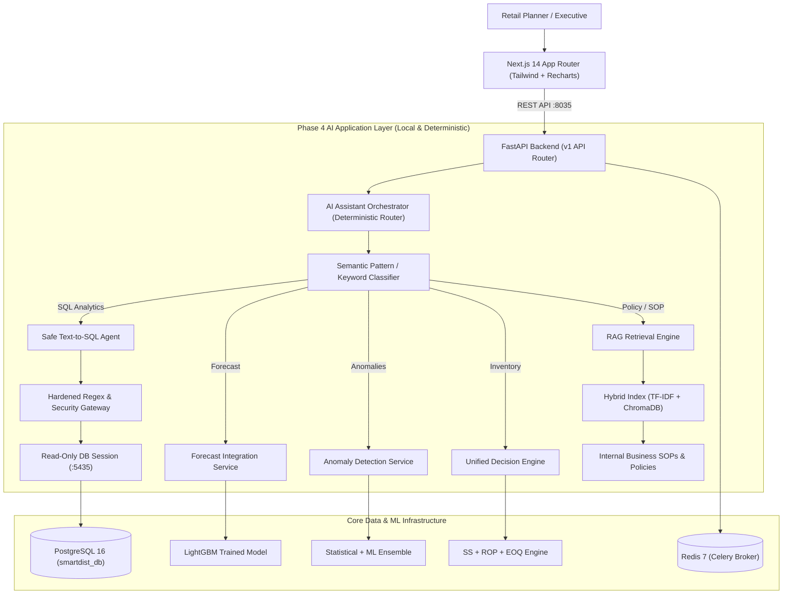

# SmartDist AI — Phase 4 System Architecture

## 1. Overview & High-Level Topology
SmartDist AI Phase 4 completes the end-to-end intelligent distribution and retail management platform by introducing:
1. **AI Business Assistant Layer (`ai_assistant/`)**: Deterministic multi-tool coordinator, semantic intent classifier, and automated multi-step business workflow engine.
2. **Safe Text-to-SQL Engine (`ai_assistant/sql_agent/`)**: Strict read-only query generator, hardened regex/keyword security gateway, table allowlist enforcement, system function blocker, row limiter, and PostgreSQL execution bridge.
3. **RAG Knowledge Retrieval System (`ai_assistant/rag/`)**: Chunked operational SOP policies, persistent TF-IDF + ChromaDB hybrid vector store, and structured citations.
4. **Next.js 14 BI Web Application (`frontend/`)**: Modern responsive App Router dashboard (Executive Overview, Sales Analytics, Demand Forecasting, Inventory Management, Anomaly Explorer, AI Copilot).

---

## 2. Core Architectural Pillars

### 2.1 Multi-Tool AI Assistant Orchestrator (Offline & Deterministic)
> [!NOTE]
> **Zero External LLM Dependency**:
> The AI Assistant Orchestrator (`ai_assistant/orchestrator.py`) is designed as a fully local, deterministic rule-based semantic router and response synthesizer. It operates without external cloud LLM dependencies (such as OpenAI, Anthropic, or Gemini APIs), guaranteeing:
> - Zero external API downtime or rate-limit failures.
> - Predictable, sub-second execution latency.
> - 100% data privacy within enterprise boundaries.
> - Complete auditability and reproducibility of results.

- **Intent Classifier**: Pattern-matching and domain keyword classifier categorizing prompts into `POLICY_SOP`, `DEMAND_FORECAST`, `INVENTORY_OPTIMIZATION`, `ANOMALY_DETECTION`, `SAFE_SQL`, or `WORKFLOW`.
- **Grounded Response Synthesis**: Synthesizes structured Markdown reports with metric cards, tables, data provenance, and citations.
- **Data Provenance Tracking**: Distinguishes between:
  - `KAGGLE_PUBLIC`: Observed 2013 Ecuadorian grocery POS transactions (648,648 rows).
  - `MODEL_GENERATED`: LightGBM forecasts and anomaly detection runs.
  - `SYNTHETIC`: Stock levels and supplier profiles.
  - `DERIVED`: Optimization calculations (SS, ROP, EOQ).
  - `POLICY_DOCS`: Standard Operating Procedures (`SOP-INV-001`, `POL-PROC-002`, `SOP-OPS-003`, `POL-STOR-004`).

### 2.2 Safe Text-to-SQL Security Architecture
- Strictly permits `SELECT` statements (including CTEs with `WITH`).
- Disallows all mutating DML and DDL: `INSERT`, `UPDATE`, `DELETE`, `DROP`, `ALTER`, `TRUNCATE`, `CREATE`, `REPLACE`, `GRANT`, `EXEC`, etc.
- Prevents multi-statement semicolon chaining and comment injection (`--` and `/* ... */`).
- Blocks PostgreSQL system metadata functions (`version()`, `current_user`, `current_database()`, `inet_server_addr()`, `pg_read_file()`, etc.).
- Prohibits implicit comma joins (`FROM a, b`) to enforce explicit ANSI JOINs.
- Enforces table allowlist (`daily_sales`, `products`, `categories`, `branches`, `warehouses`, `suppliers`, `product_suppliers`, `inventory`, `sales_anomalies`, `anomaly_detection_runs`).
- Enforces max row limit $\le 100$ (default 50) and execution timeout (`SET LOCAL statement_timeout = '5000ms'`).

### 2.3 RAG Knowledge Architecture
- Business policy documents indexed under `ai_assistant/rag/documents/`:
  - `sop_inventory_replenishment.md`: CSL targets, safety stock formulas, ROP, EOQ, risk tiers.
  - `procurement_policy.md`: Supplier tiers, lead times, PO approval limits.
  - `sales_anomaly_guidelines.md`: Spike/drop thresholds, root cause checklist, triage protocols.
  - `store_operations.md`: Store formats, receiving windows, emergency transfer rules.
- Document chunking by semantic sections with heading metadata.
- Hybrid vector representation: high-speed Scikit-learn TF-IDF + ChromaDB persistent vector storage.
