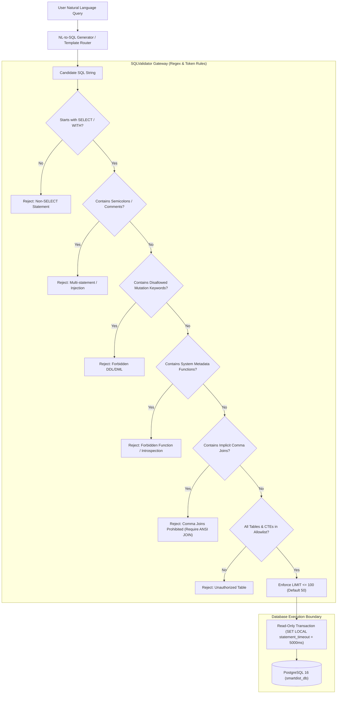

# SmartDist AI — Safe Text-to-SQL Security Architecture

## 1. Threat Model & Design Principles
Allowing AI systems to generate and execute SQL queries poses critical security risks in enterprise environments:
1. **Destructive SQL Injection**: Attackers embedding `DROP TABLE`, `TRUNCATE`, `DELETE`, or `ALTER`.
2. **System Introspection & Exfiltration**: Querying database system catalogs (`pg_catalog`, `information_schema`) or calling environment introspection functions (`version()`, `current_user`, `inet_server_addr()`, `pg_read_file()`).
3. **Denial of Service**: Heavy unbounded queries without `LIMIT` or Cartesian join attacks exhausting memory and database connections.
4. **Multi-Statement Attacks**: Semicolon chaining (`;`) to execute secondary unauthorized payloads.
5. **Join Bypasses**: Implicit comma joins (`FROM allowed_table, secret_table`) attempting to circumvent single-table pattern checks.

SmartDist AI employs a **Zero-Trust SQL Security Gateway** architecture.

> [!NOTE]
> **Implementation Specification: Hardened Regex & Keyword Security Gateway**
> The SQL validation engine in `ai_assistant/sql_agent/sql_validator.py` operates as a hardened regular-expression, keyword boundary, and structural token parsing gateway. It is specifically designed to enforce safety on analytical queries targeting internal business tables. It intentionally does not implement a full SQL AST compiler, but enforces strict perimeter rules, rejecting dialect-specific metadata calls, implicit comma joins, and non-whitelisted constructs before database execution.

---

## 2. Multi-Layer Security Pipeline

---

## 3. Strict Whitelists & Limits

### 3.1 Allowed Tables
Only 10 tables are accessible to the Safe Text-to-SQL engine:
- `daily_sales`
- `products`
- `categories`
- `branches`
- `warehouses`
- `suppliers`
- `product_suppliers`
- `inventory`
- `sales_anomalies`
- `anomaly_detection_runs`

Any table not explicitly listed (including CTE aliases not scoped to allowed sources) is rejected immediately with `SQLValidationError`.

### 3.2 Blocked Mutation & Recursive Keywords
The following SQL keywords trigger immediate validation failure:
`INSERT`, `UPDATE`, `DELETE`, `DROP`, `ALTER`, `TRUNCATE`, `CREATE`, `REPLACE`, `GRANT`, `REVOKE`, `EXEC`, `EXECUTE`, `CALL`, `COPY`, `VACUUM`, `REINDEX`, `EXPLAIN`, `PREPARE`, `DEALLOCATE`, `DECLARE`, `LOCK`, `SET`, `RESET`, `SHOW`, `INTO` (in write context), `OUTFILE`, `DUMPFILE`, `PG_SLEEP`, `DBLINK`, `RECURSIVE`.

### 3.3 Blocked System Schemas & Catalogs
Queries referencing any system catalog or engine internal schema are blocked:
`information_schema`, `pg_catalog`, `pg_temp`, `pg_toast`, `sqlite_master`, `mysql`, `performance_schema`, `sys`.
Additionally, if a table identifier uses a schema prefix (`schema.table`), only the `public` schema is permitted; any other schema qualifier is rejected.

### 3.4 Blocked System Functions, Set-Returning Functions & Environment Metadata
To prevent reconnaissance, server metadata leaks, and row-amplification Denial-of-Service, the following functions and identifiers (plus any `pg_*()` internal function call) are explicitly blocked:
`VERSION`, `CURRENT_USER`, `SESSION_USER`, `SYSTEM_USER`, `USER`, `CURRENT_ROLE`, `CURRENT_DATABASE`, `CURRENT_CATALOG`, `CURRENT_SCHEMA`, `CURRENT_SCHEMAS`, `CURRENT_SETTING`, `CURRENT_QUERY`, `INET_SERVER_ADDR`, `INET_SERVER_PORT`, `INET_CLIENT_ADDR`, `INET_CLIENT_PORT`, `PG_BACKEND_PID`, `PG_STAT_FILE`, `PG_READ_FILE`, `PG_READ_BINARY_FILE`, `PG_LS_DIR`, `PG_SLEEP`, `PG_TERMINATE_BACKEND`, `PG_CANCEL_BACKEND`, `PG_MY_TEMP_SCHEMA`, `PG_CONF_LOAD_TIME`, `PG_POSTMASTER_START_TIME`, `PG_IS_IN_RECOVERY`, `HAS_TABLE_PRIVILEGE`, `HAS_SCHEMA_PRIVILEGE`, `HAS_DATABASE_PRIVILEGE`, `HAS_COLUMN_PRIVILEGE`, `DBLINK`, `DBLINK_EXEC`, `TXID_CURRENT`, `GENERATE_SERIES`, `UNNEST`, `JSON_EACH`, `JSONB_EACH`, `JSON_TO_RECORDSET`, `JSONB_TO_RECORDSET`, `REGEXP_SPLIT_TO_TABLE`, `XPATH`.

### 3.5 Enforcement of ANSI JOIN Syntax & CTE Scoping
Implicit comma joins (`SELECT * FROM table1, table2`) are strictly prohibited to prevent table-bypass evasion. All multi-table relationships must use explicit ANSI JOIN syntax (`INNER JOIN`, `LEFT JOIN`, `RIGHT JOIN`, `CROSS JOIN` on allowed tables). Multiple non-recursive CTE definitions (`WITH c1 AS (...), c2 AS (...)`) are supported provided that every source table inside CTE bodies is in `ALLOWED_TABLES` and at least one physical table is referenced.

### 3.6 Row Limits, Statement Timeout & Read-Only Transaction
- If no `LIMIT` is specified in the query, `LIMIT 50` is automatically appended.
- If `LIMIT N` is specified and $N > 100$, it is rewritten to `LIMIT 100`.
- The database connection enforces `SET LOCAL statement_timeout = '5000ms'` and `SET LOCAL transaction_read_only = on` in a dedicated read-only transaction (rolled back on completion), terminating any query that executes longer than 5 seconds or attempts any engine-level write.
