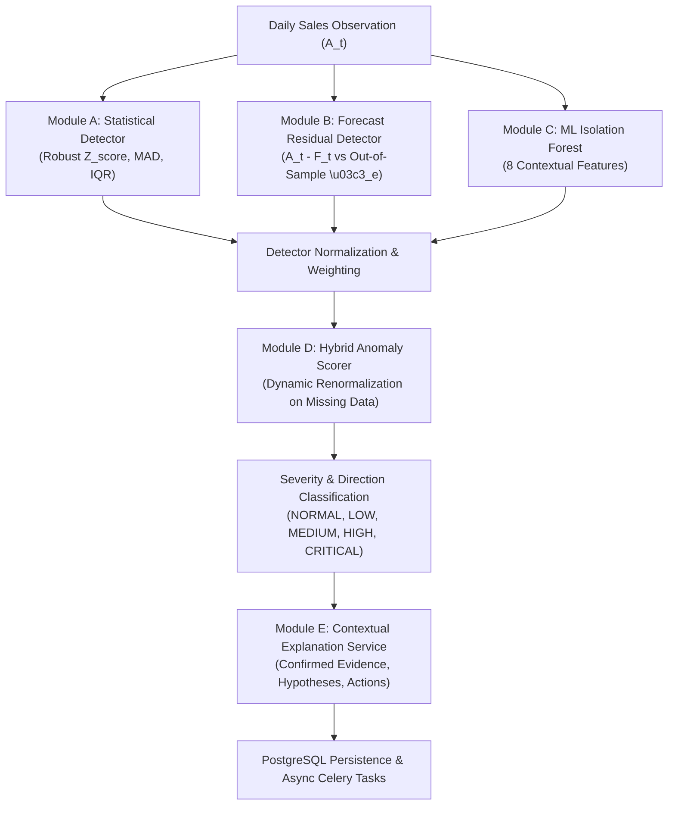

# SmartDist AI — Sales Anomaly Detection Architecture

## 1. Architectural Philosophy & Objective

In enterprise retail distribution, anomalous sales patterns provide early operational signals of underlying supply chain friction, unrecorded stockouts, pricing distortions, promotional shocks, or point-of-sale data entry failures.

Traditional single-rule thresholding (such as fixed percentage bounds or global $3\sigma$ filters) suffers from dual systemic vulnerabilities:
1. **False Alarm Saturation**: Naturally volatile, promotional, or high-velocity categories trigger constant false alerts.
2. **Blindness in Sparse Series**: Low-velocity categories (e.g. Automotive, Appliances) where a drop to zero is treated identically to normal inactivity, hiding critical stockouts.

**SmartDist AI Phase 4.1** implements a **Hybrid Anomaly Detection Architecture** combining statistical time-series dispersion, out-of-sample forecast deviation, and semi-supervised machine learning isolation trees.

---

## 2. Detection Modules

### 2.1 Module A: Robust Statistical Anomaly Detection
- **Formula**:
  $$Z_{\text{robust}} = \frac{0.6745(x_t - \operatorname{median}(X))}{\operatorname{MAD}(X)}$$
  $$\operatorname{MAD}(X) = \operatorname{median}(|x_i - \operatorname{median}(X)|)$$
- **Zero-Leakage Baseline**: For observation at day $t$, baseline $X$ strictly consists of historical sales in the window $[t - 28, t - 1]$. The current observation $x_t$ is strictly excluded from its own baseline calculation.
- **Zero-MAD Safeguard**: When historical demand is completely flat ($\operatorname{MAD} = 0$):
  - If standard deviation $\sigma > 0$, scales by $\sigma$.
  - If $\sigma = 0$ and $x_t = \operatorname{median}$, $Z_{\text{robust}} = 0.0$.
  - If $\sigma = 0$ and $x_t \ne \operatorname{median}$, clamps safely to $\pm 10.0$, eliminating divide-by-zero errors.

### 2.2 Module B: Forecast Residual Anomaly Detection
- Reuses the LightGBM multi-horizon demand forecasting model and genuine out-of-sample validation residuals (November 2013).
- Standardized error score:
  $$Z_{\text{forecast}} = \frac{(A_t - F_t) - \mu_e}{\sigma_e}$$
- Hierarchical fallback (`SERIES` $\to$ `PRODUCT_POOLED` $\to$ `FAMILY_POOLED`) ensures dispersion estimates are available without using in-sample training residuals or global RMSE.

### 2.3 Module C: Machine Learning Isolation Forest
- Trained strictly on chronological training features ($\le \text{2013-10-31}$).
- Input features: `quantity_sold`, `lag_1`, `lag_7`, `rolling_mean_7`, `rolling_std_7`, `day_of_week`, `is_weekend`, `promotion_quantity`.
- Maps decision function to a calibrated probability in $[0.0, 1.0]$ via logistic scaling:
  $$S_{\text{ml}} = \frac{1}{1 + \exp(10 \cdot \text{decision\_function}(X))}$$

### 2.4 Module D: Hybrid Anomaly Scorer
- Default weights: Statistical ($0.40$), Forecast Residual ($0.35$), ML Isolation Forest ($0.25$).
- **Dynamic Renormalization**: When any detector reports `INSUFFICIENT_DATA`, the active weights are renormalized:
  $$w'_i = \frac{w_i}{\sum_{j \in \text{available}} w_j}, \quad S_{\text{hybrid}} = \sum_{i} w'_i S_i$$
- **Severity Mapping**:
  - $[0.00, 0.40) \to \text{NORMAL}$
  - $[0.40, 0.60) \to \text{LOW}$
  - $[0.60, 0.75) \to \text{MEDIUM}$
  - $[0.75, 0.90) \to \text{HIGH}$
  - $[0.90, 1.00] \to \text{CRITICAL}$

### 2.5 Module E: Contextual Explanation & Action Engine
Translates detector outputs into deterministic, structured plain-language summaries separating:
1. **Confirmed Evidence**: Factual numerical observations and standardized Z-scores.
2. **Possible Explanations**: Contextual operational hypotheses (promotions, competitor stockouts, shelf stockouts, data errors).
3. **Recommended Actions**: Actionable audit steps for store managers and purchasing teams.

---

## 3. Data Flow & Granularity

- **Granularity**: Daily store-product sales records (`daily_sales`).
- **Data Provenance**:
  - `KAGGLE_PUBLIC`: Observed sales transactions (Store Sales dataset).
  - `MODEL_GENERATED`: Forecasts and residual distributions.
  - `SYNTHETIC`: Benchmark injection evaluations.
- **Scope Disclaimer**: Evaluates daily store-level volumes. Does not perform invoice-level fraud detection or real-time sub-second POS streaming.
