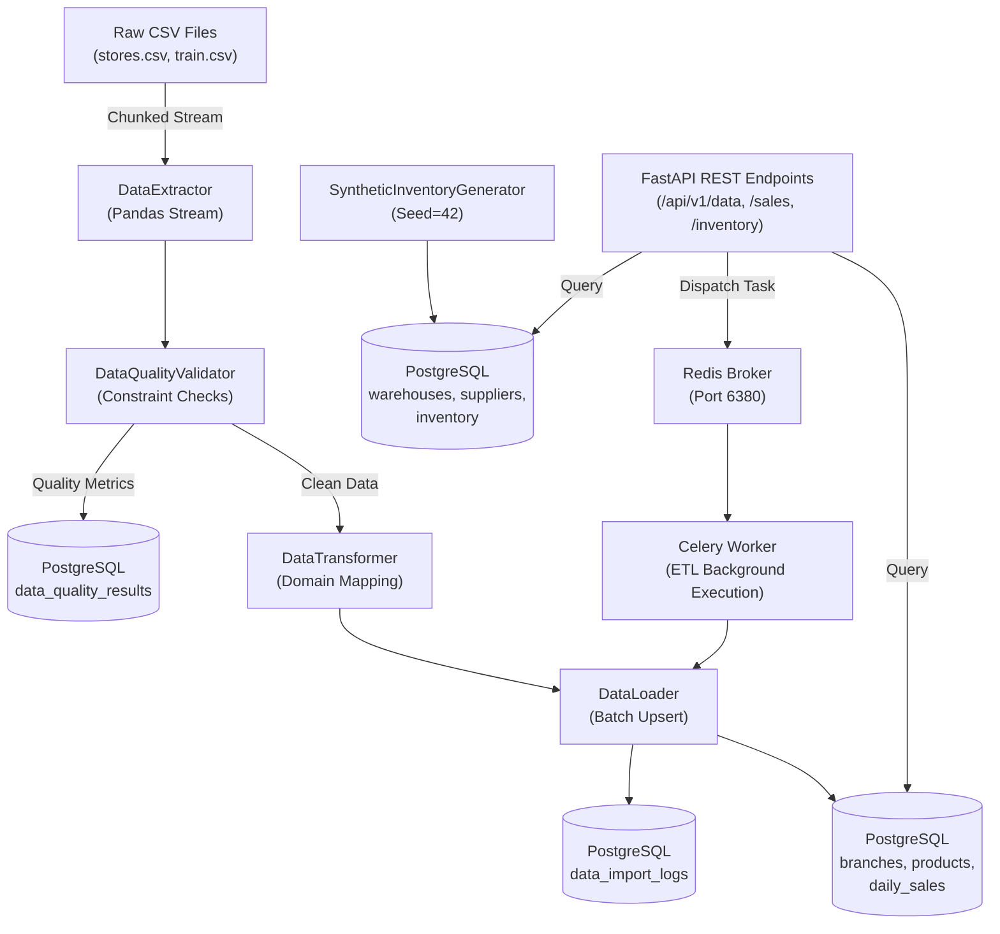

# Data Flow Architecture

This document describes how operational and analytical data flows between ingestion sources, processing workers, relational storage, and API clients.

## Data Lifecycle

1. **Extraction**: Raw files in `ml/data/raw` are streamed without memory spikes.
2. **Quality Verification**: Each batch is validated against referential and domain rules before touching persistent storage.
3. **Audit Tracking**: Import execution timestamps, processed rows, and rejected counts are recorded.
4. **Consumption**: Downstream analytical endpoints read indexed tables with sub-millisecond retrieval speeds.
