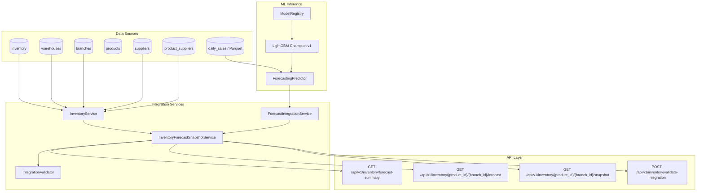

# SmartDist AI — Phase 3.3.1 Architecture Assessment
## Inventory Data & Demand Forecast Integration

**Author**: Senior Machine Learning Engineer, Data Engineer & Backend Architect  
**Date**: November 9, 2026  
**Status**: APPROVED FOR IMPLEMENTATION  
**Subphase**: 3.3.1 (Integration Foundation for Inventory Optimization)

---

## 1. Context & Architectural Overview

SmartDist AI is transitioning from standalone demand forecasting (Phase 3.2) into operational inventory optimization (Phase 3.3). Phase 3.3.1 establishes the foundational data and service integration layer that bridges:
1. Physical and reserved inventory balances across regional warehouses.
2. Machine learning demand forecasts from the champion LightGBM model.
3. Supplier catalog mappings, lead times, and replenishment constraints.
4. Product and branch relational hierarchies.

---

## 2. Assessment of Existing Components

### 2.1 Reusable Components
- **Business Models (`backend/app/models/business.py`)**:
  - `Product`: Master catalog, `data_origin="KAGGLE_PUBLIC"`.
  - `Branch`: Retail stores with `source_store_number` matching ML training series `store_nbr`.
  - `Warehouse`: Regional facilities (`WH-NORTH-01`, `WH-COAST-01`, `WH-SOUTH-01`, `WH-CENTRAL-01`) mapped to primary branches via `branch_id`.
  - `Inventory`: Physical stock (`stock_quantity`), allocated stock (`reserved_quantity`), threshold fields (`safety_stock`, `reorder_point`), and `data_origin="SYNTHETIC"`.
  - `Supplier` & `ProductSupplier`: Lead times (`lead_time_days`), minimum order quantities (`minimum_order_quantity`), and unit purchasing costs.
- **ML Inference (`ml/inference/predictor.py` & `ml/training/model_registry.py`)**:
  - `ModelRegistry`: Successfully registers, loads, and manages the champion LightGBM model artifact (`lightgbm_v1.joblib`).
  - `ForecastingPredictor`: Production engine supporting recursive multi-step forecasting for 7, 14, and 30 days without lookahead bias.
- **API Framework & Middleware**:
  - FastAPI modular router (`backend/app/api/v1/router.py`) with dependency injection for database sessions (`get_db`) and Redis caching.

### 2.2 Identified Gaps & Data Nuances
1. **Inventory to Branch Relationship**:
   - `Inventory` is explicitly keyed by `(product_id, warehouse_id)`.
   - `Warehouse` is linked to `branch_id` (4 regional warehouses mapped to branches 1, 24, 37, 50).
   - Other branches (e.g., branch 2, branch 3) operate as retail storefronts replenished by regional distribution centers or do not yet have standalone warehouse inventory records.
   - *Design Decision*: Direct warehouse lookup is prioritized. When a branch has no warehouse record, the service will not invent or silently fabricate stock; instead, it will report `None` for current stock and flag `MISSING_INVENTORY` in data validation.
2. **Forecasting Target & Unit Alignment**:
   - The forecasting target is strictly `quantity_sold` (physical units/volume).
   - Inventory quantities (`stock_quantity`, `reserved_quantity`) are integers in standard units.
   - Demand forecasts and inventory units are completely aligned.
3. **Data Provenance Transparency**:
   - Sales observations originate from `KAGGLE_PUBLIC`.
   - Inventory, warehouse, and supplier records originate from `SYNTHETIC`.
   - Snapshots must explicitly retain and surface `data_origin` for auditing integrity.
4. **Zero vs. Unavailable Distinction**:
   - An unobserved series or missing history must return `status="UNAVAILABLE"`, not a fabricated `0.0`. Genuine zero-demand forecasts must be distinguished by valid prediction records with value `0.0`.

---

## 3. Implementation Plan & Service Responsibilities

1. **`InventoryService`** (`backend/app/services/inventory_service.py`):
   - Fetches product, branch, warehouse, and inventory balances.
   - Computes `available_stock = current_stock - reserved_stock`.
   - Resolves supplier details (lead time, MOQ, unit cost).
   - Enforces non-negative stock constraints and reserved stock validation.
2. **`ForecastIntegrationService`** (`backend/app/services/forecast_service.py`):
   - Loads the champion LightGBM model from `ModelRegistry`.
   - Retrieves historical series context.
   - Executes recursive multi-step forecasting via `ForecastingPredictor` for 7, 14, and 30 days.
   - Validates for NaN, infinity, and invalid negative outputs.
3. **`InventoryForecastSnapshotService`** (`backend/app/services/snapshot_service.py`):
   - Unifies inventory status with forecast horizons.
   - Calculates aggregate metrics:
     - `total_forecast_demand = sum(daily_predicted_demand)`
     - `average_daily_demand = total_forecast_demand / number_of_forecast_days`
     - `peak_daily_demand = max(daily_predicted_demand)`
   - Surfaces data provenance and model traceability metadata.
4. **`IntegrationValidator`** (`backend/app/services/integration_validator.py`):
   - Executes multi-point data quality checks (missing inventory, missing supplier, missing lead time, invalid values, stale data).
   - Generates structured validation items with `PASS`, `WARNING`, and `FAIL` severities.
5. **API Endpoints & Schemas** (`backend/app/api/v1/endpoints/inventory.py` & `backend/app/schemas/inventory_forecast.py`):
   - Fast, paginated, and typed REST interfaces.
6. **Automated Pytest Coverage**:
   - Unit tests covering inventory calculation, mocked forecasting, snapshot aggregations, validator rules, and API contracts.
