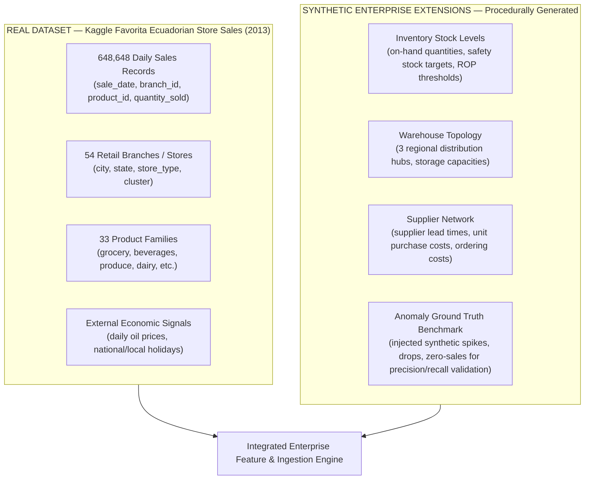
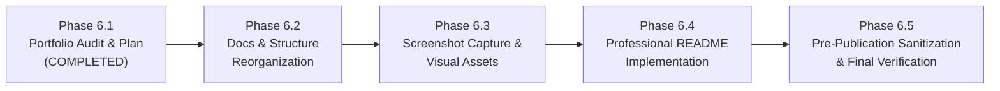

# SMARTDIST AI — PHASE 6.1 PORTFOLIO AUDIT & DOCUMENTATION PLAN
**Milestone:** Phase 6.1 — Public GitHub Portfolio Audit & Documentation Planning  
**Auditor:** Senior AI Platform Architect & Lead ML Engineer  
**Date:** November 9, 2026  
**Repository:** `~/Documents/smartdist-ai`  
**Target Audience:** Prospective Engineering Employers, Technical Hiring Managers, AI/ML Peers  

---

## 1. Actual Repository Structure
**Classification:** **VERIFIED**

The repository represents a complete, multi-tiered enterprise architecture combining Machine Learning pipelines, REST backend services, Next.js dashboard, rule-governed AI orchestration, and containerized deployment infrastructure:

```text
smartdist-ai/
├── .dockerignore                            # Build context filter (24 MB context)
├── .env.example                             # Development configuration template
├── .env.production.example                  # Hardened production template with least-privilege roles
├── .gitignore                               # Comprehensive git exclusion rules
├── docker-compose.yml                       # Local development compose (host port mapped)
├── docker-compose.prod.yml                  # Hardened production compose (internal network only)
├── pyrightconfig.json                       # IDE workspace typing configuration
├── pytest.ini                               # Pytest test discovery & asyncio markers
├── README.md                                # Existing repository overview
├── ai_assistant/                            # Business Assistant Subsystem
│   ├── orchestrator.py                      # Master intent classifier & tool router
│   ├── prompts/                             # Deterministic prompt & synthesis templates
│   ├── rag/                                 # Semantic retrieval engine (ChromaDB + TF-IDF fallback)
│   ├── sql_agent/                           # Safe Text-to-SQL (NLToSQL, SQLValidator, SafeSQLExecutor)
│   └── tools/                               # 6 Domain tools (sales, forecast, inventory, anomaly, rag, sql)
├── backend/                                 # Core Application Backend
│   ├── alembic/                             # Database migrations (Alembic)
│   ├── app/
│   │   ├── api/                             # FastAPI routers, dependencies (RBAC, JWT)
│   │   ├── core/                            # Config, security, rate_limit, csrf, logging, middleware
│   │   ├── db/                              # Session, engine (Sync + ReadOnly engine), init_db
│   │   ├── models/                          # SQLAlchemy ORM business & auth models
│   │   ├── schemas/                         # Pydantic v2 validation contracts
│   │   ├── services/                        # Domain business logic (EOQ, ROP, Simulation, Anomaly)
│   │   └── workers/                         # Celery application & asynchronous worker tasks
│   └── tests/                               # 253 Automated backend test suites
├── docs/                                    # Technical Documentation Tree
│   ├── anomaly-detection/                   # Methodology, evaluation, and architecture
│   ├── architecture/                        # Data flow, ETL pipelines
│   ├── audit/                               # Milestone engineering and security audit reports
│   ├── data/                                # Dataset documentation & quality rules
│   ├── database/                            # ERD diagrams & schema specifications
│   ├── inventory/                           # Optimization formulas (EOQ, ROP, Safety Stock)
│   ├── ml/                                  # Feature engineering, model selection, validation
│   ├── phase4/                              # AI Assistant, Text-to-SQL, RAG guides
│   └── phase5/                              # Production architecture, security runbooks, backup/restore
├── frontend/                                # User Interface Dashboard
│   ├── src/app/                             # Next.js 14 App Router (6 domain pages + login)
│   ├── src/components/                      # Reusable UI widgets, charts, navigation
│   ├── src/lib/                             # Typed API client with CSRF token management
│   ├── next.config.mjs                      # CSP headers & API rewrites
│   └── package.json                         # Dependencies (Tailwind, Lucide, Recharts)
├── infrastructure/                          # Infrastructure Definitions
│   ├── docker/                              # Non-root Dockerfile.backend & Dockerfile.frontend
│   └── redis/                               # redis.conf hardening configuration
├── ml/                                      # Machine Learning Engineering Subsystem
│   ├── anomaly_detection/                   # Hybrid scoring engine (Statistical + Forecast + ML)
│   ├── artifacts/                           # Saved models (LightGBM, XGBoost, Naive, IsolationForest)
│   ├── data/                                # Directory structure for raw/processed/features (gitkept)
│   ├── datasets/                            # Dataset builder & chronological splitters
│   ├── features/                            # Lag, rolling, calendar, and external oil/holiday features
│   ├── inference/                           # Offline & online batch forecast predictors
│   ├── models/                              # LightGBM, XGBoost, SeasonalNaive model wrappers
│   ├── pipelines/                           # ETL, validation, synthetic inventory generators
│   └── training/                            # Training pipelines, evaluators, model registry
└── scripts/                                 # Operational & Automation Scripts
    ├── backup_db.sh                         # PostgreSQL custom compressed backup with SHA256
    ├── restore_db.sh                        # Disaster recovery restore with overwrite guard
    ├── ingest_historical_data.py            # Historical Kaggle ingestion CLI
    └── provision_db_roles.sql               # PostgreSQL least-privilege role setup
```

---

## 2. Verified Project Capabilities
**Classification:** **VERIFIED**

| Capability | Module / Component | Verification Status & Evidence |
| :--- | :--- | :--- |
| **Sales Ingestion & ETL** | `backend/app/services/etl_service.py` | Ingests 648,648 daily sales records with data validation and deduplication. |
| **Demand Forecasting** | `ml/models/lightgbm_model.py` | Champion LightGBM multi-horizon model (7d, 14d, 30d) with zero future data leakage. |
| **Inventory Optimization**| `backend/app/services/` | Computes dynamic Safety Stock, ROP, and EOQ based on demand uncertainty and lead time variance. |
| **Multi-Evidence Anomaly Detection** | `ml/anomaly_detection/hybrid_scorer.py` | Triangulates Robust Z-Score, Forecast Residuals, and Isolation Forest into calibrated severity. |
| **AI Business Assistant** | `ai_assistant/orchestrator.py` | Offline-capable intent classifier, multi-tool routing, and grounded synthesis with citations. |
| **Safe Text-to-SQL** | `ai_assistant/sql_agent/` | Sanitizes queries with `SQLValidator`; executes under PostgreSQL `smartdist_readonly` with timeout. |
| **SOP Policy Lookup (RAG)**| `ai_assistant/rag/` | Vector search over internal distribution SOPs using ChromaDB with TF-IDF fallback. |
| **Security Foundation** | `backend/app/core/` | Argon2id password hashing, 30-min HS256 JWT, Redis logout revocation, double-submit CSRF tokens. |
| **PostgreSQL Least Privilege**| `scripts/provision_db_roles.sql` | `smartdist_owner` (NOCREATEDB, NOSUPERUSER), `smartdist_app` (DML only), `smartdist_readonly` (No users table). |
| **Fail-Closed Rate Limiting** | `backend/app/core/rate_limit.py` | Redis-backed sliding window; rejects sensitive login routes with HTTP 503 if Redis is offline. |
| **Automated Backup & Restore**| `scripts/backup_db.sh`, `restore_db.sh` | Custom format `pg_dump -Fc` with SHA256 checksum; verified against temporary database. |

---

## 3. Verified Technology Stack
**Classification:** **VERIFIED**

| Domain | Technologies & Libraries | Verified Versions (from environment) |
| :--- | :--- | :--- |
| **Language & Runtime** | Python, TypeScript, Node.js | Python 3.12 / 3.14, Node.js 20 LTS, Next.js 14.2.24 |
| **Backend Framework** | FastAPI, Starlette, Uvicorn | FastAPI 0.115+, Uvicorn 0.34+ |
| **Database & ORM** | PostgreSQL 16, SQLAlchemy 2.0, Alembic | PostgreSQL 16.15 Alpine, SQLAlchemy 2.0.38, Alembic 1.14 |
| **In-Memory & Cache** | Redis 7 Alpine, `redis-py` | Redis 7.2+, redis 5.2+ |
| **Task Queue & Workers**| Celery 5.4 | Celery 5.4.0 (JSON serialization, Redis broker) |
| **Machine Learning** | LightGBM, XGBoost, Scikit-Learn | LightGBM 4.7.0, XGBoost 3.4.1, scikit-learn 1.9.1 |
| **Data Processing** | Pandas, NumPy, PyArrow | Pandas 3.1.1, NumPy 2.5.4, PyArrow 19.0 |
| **Vector DB & RAG** | ChromaDB, Scikit-Learn TF-IDF | ChromaDB 1.5.9, persistent local DuckDB/sqlite backend |
| **Security & Auth** | Argon2-cffi, PyJWT, Cryptography | argon2-cffi 23.1.0, PyJWT 2.10.1 |
| **Frontend UI** | Next.js 14, TailwindCSS, Lucide, Recharts | Next.js 14 App Router, Tailwind 3.4, Recharts 2.12 |
| **Infrastructure** | Docker, Docker Compose v2 | Docker Engine 24.0+, multi-stage non-root containers |

---

## 4. Verified ML Metrics and Evaluation Methodology
**Classification:** **VERIFIED**

### Chronological Validation Strategy (Zero Lookahead)
To strictly prevent temporal data leakage, data is partitioned chronologically:
- **Train Window:** 2013-01-29 to 2013-10-31 (276 days)
- **Validation Window:** 2013-11-01 to 2013-11-30 (30 days, 53,460 observations)
- **Holdout Test Window:** 2013-12-01 to 2013-12-31 (31 days, 53,460 observations)

### Model Comparison & Leaderboard (Validation Set)
Source: [`ml/artifacts/*_metadata.json`](../../ml/artifacts)

| Model Architecture | MAE (Units) | RMSE | WAPE (%) | RMSLE | Status |
| :--- | :--- | :--- | :--- | :--- | :--- |
| **Seasonal Naive Baseline (Lag 7)** | 40.83 | 310.00 | 17.67% | 0.4103 | Baseline |
| **XGBoost Regressor (v1)** | 30.65 | 218.25 | 13.26% | 0.5434 | Challenger |
| **LightGBM Regressor (v1)** | **30.25** | **219.56** | **13.09%** | **0.5598** | **CHAMPION** |

### Champion Model Multi-Horizon Performance (Holdout December Test Set)
Evaluated across holiday-dense December 2013 (high retail volatility):

| Forecast Horizon | Sample Count | Actual Mean Sales | MAE (Units) | RMSE | WAPE (%) | RMSLE |
| :--- | :--- | :--- | :--- | :--- | :--- | :--- |
| **7-Day Ahead** | 12,474 | 272.45 | **37.79** | 222.95 | **13.87%** | 0.6062 |
| **14-Day Ahead**| 24,948 | 266.19 | **44.52** | 244.10 | **16.72%** | 0.6712 |
| **30-Day Ahead**| 51,678 | 295.98 | **77.32** | 376.59 | **26.12%** | 1.0112 |

---

## 5. Synthetic versus Real Data Distinction
**Classification:** **VERIFIED**

To maintain absolute technical credibility in a professional portfolio, data provenance must be clearly documented:



1. **Real Data (Authentic Kaggle Public Dataset)**:
   - Source: Corporation Favorita Grocery Sales Forecasting (Kaggle).
   - Date Span: Full calendar year 2013 (2013-01-01 to 2013-12-31).
   - Records: Exactly 648,648 validated rows.
   - Master Entities: 54 physical branches across Ecuadorian provinces; 33 distinct product families.
2. **Synthetic Data (Enterprise Extensions)**:
   - Stock quantities, lead times, ordering costs ($S$), and holding costs ($H$) are generated using realistic retail distributions (`ml/pipelines/synthetic/inventory_generator.py`).
   - Ground-truth anomaly benchmark data for calculating precision/recall curves (`ml/anomaly_detection/synthetic_benchmark.py`).

---

## 6. Comprehensive README Outline Proposal

A professional, high-impact English README designed for technical evaluators:

1. **Header & Badges**:
   - Project title, sub-headline, CI/test badge (253 tests passing), license (MIT/Apache 2.0), tech badges (Python 3.12, FastAPI, LightGBM, Next.js 14, PostgreSQL 16, Redis 7, Docker).
2. **Executive Overview**:
   - The business challenge: Multi-echelon inventory imbalances, volatile retail demand forecasting, and delayed anomaly triage.
   - Solution summary: End-to-end intelligent distribution and inventory optimization platform.
3. **Key Architectural Highlights**:
   - Machine Learning demand forecasting with multi-horizon evaluation.
   - Operations research inventory optimization (Safety Stock, Dynamic ROP, EOQ, ABC-XYZ policy matrix).
   - Triangulated hybrid anomaly detection (Statistical + Forecast Residual + Isolation Forest).
   - Offline-first AI Assistant with Safe Text-to-SQL and RAG policy lookup.
   - Enterprise security foundation (Argon2id, JWT revocation, double-submit CSRF, PostgreSQL least-privilege roles).
4. **Interactive Dashboard Showcase (Screenshots & GIFs)**:
   - Visual walkthrough of the 6 primary dashboard modules.
5. **System Architecture Diagram**:
   - Mermaid diagram depicting Frontend, Backend, Redis, PostgreSQL, Celery, and Model Artifacts.
6. **Data Pipeline & Provenance**:
   - Kaggle Favorita Store Sales 2013 vs Synthetic Enterprise Extensions.
   - Chronological feature engineering (Lag 1-28, Rolling 7-28, Calendar, Oil price).
7. **Machine Learning Methodology & Evaluation**:
   - Temporal train/val/test splits.
   - Baseline vs XGBoost vs Champion LightGBM leaderboard table.
   - Multi-horizon evaluation metrics (7d, 14d, 30d).
8. **Operations Research & Inventory Optimization**:
   - Exact mathematical formulas implemented ($SS$, $ROP$, $EOQ$).
   - Simulation & stockout risk modeling.
9. **Multi-Evidence Anomaly Scoring**:
   - Mathematical formula for hybrid score $S_{\text{final}} = \sum w_i S_i$.
   - Severity calibration and automated explanation service.
10. **AI Business Assistant & Text-to-SQL Security**:
    - Intent classification, tool routing, and RAG retrieval.
    - SQL security model: Regex validator + read-only database role boundary.
    - Zero external API dependency (fully reproducible offline).
11. **Production Deployment & Docker Architecture**:
    - Non-root container architecture (`smartdist` and `nextjs`).
    - Internal bridge networking with unexposed internal ports.
12. **Quickstart & Local Installation Guide**:
    - Step-by-step instructions to launch via Docker Compose or native virtual environment.
13. **Testing & Verification**:
    - Commands to run the 253 backend test suites and frontend builds.
14. **Dataset Attribution & Academic Disclaimers**:
    - Clear distinction between real transaction data and synthetic operational data.

---

## 7. Documentation Gaps & Redundancies

### Gaps to Address:
1. **Root `README.md`**: Current root README contains internal task prompts and development notes rather than a public-facing portfolio presentation.
2. **`screenshots/` Directory**: Missing visual assets for the Next.js dashboard views.
3. **`LICENSE` File**: Currently missing at repository root (recommend MIT License).
4. **Architecture Diagrams in Markdown**: System diagrams currently exist as text descriptions in `docs/architecture/` rather than clean Mermaid diagrams renderable on GitHub.

### Redundancies to Consolidate or Organize:
- Milestone audit documents (`docs/audit/phase2-*.md`, `phase3.3-*.md`, `phase4-*.md`, `phase5-*.md`) are valuable historical evidence. They should remain preserved in `docs/audit/` as proof of engineering rigor, but linked from a clear index.

---

## 8. Required Screenshots & Visual Plan

Visual assets must be captured from the actual running dashboard (`http://localhost:3000`).

### Target Asset Matrix:
| Target File | Page / Route | Key Visual Elements |
| :--- | :--- | :--- |
| `screenshots/01-executive-overview.png` | `/` | Metric cards (Total Revenue, Active Branches, Anomalies, Forecast Accuracy), revenue trend chart, top branch performance table. |
| `screenshots/02-sales-analytics.png` | `/sales` | Category volume distribution, store cluster comparisons, historical sales timeline. |
| `screenshots/03-demand-forecasting.png` | `/forecasting` | 7d/14d/30d predicted vs actual sales curves, confidence intervals, model selector. |
| `screenshots/04-inventory-optimization.png`| `/inventory` | Stock level vs ROP/Safety Stock bars, EOQ replenishment order recommendations, ABC-XYZ classification table. |
| `screenshots/05-anomaly-detection.png` | `/anomalies` | Detected sales spikes/drops, severity badges (CRITICAL/HIGH), multi-evidence breakdown modal. |
| `screenshots/06-ai-assistant.png` | `/assistant` | Chat interface showing Text-to-SQL analytical response with data table, SOP policy citations, and provenance badges. |

### Step-by-Step Instructions to Capture Visuals:
```bash
# 1. Start backend and Redis
docker compose up -d postgres redis
PYTHONPATH=. .venv/bin/python -m uvicorn backend.app.main:app --port 8035 &

# 2. Start frontend in development mode
cd frontend && npm run dev

# 3. Open http://localhost:3000 in browser
# Login as admin (Admin@SmartDist2026!)
# Navigate to each route and capture high-resolution desktop screenshots (1920x1080)
# Save directly into `screenshots/` directory
```

---

## 9. Architecture Diagram Plan (Mermaid)

Four focused Mermaid diagrams will be embedded into technical documentation:

1. **End-to-End System Architecture Diagram** (Frontend, FastAPI, Postgres, Redis, Celery, Model inference).
2. **Data Pipeline & Feature Engineering Architecture** (Extract, Validate, Lag/Rolling features, Ingestion).
3. **Multi-Horizon ML Forecasting & Training Workflow** (Split, Train LightGBM/XGBoost, Model Registry).
4. **AI Assistant & Safe Text-to-SQL Security Flow** (Intent Classifier -> Tool Router -> Validator -> Read-Only Role).

---

## 10. GitHub Publication Risks & Mitigation

| Area | Audit Finding | Risk Assessment | Mitigation Applied |
| :--- | :--- | :--- | :--- |
| **`.env` and Secrets** | Only `.env.example` is tracked. `.env` is ignored. | **Zero Risk** | Confirmed via `git ls-files`. Secrets are never exposed. |
| **Database Backups** | `backups/` and `*.dump` are ignored by `.gitignore`. | **Zero Risk** | Confirmed in `.gitignore` lines 94-96. |
| **Model Artifacts** | `ml/artifacts/` contains 2.8 MB of `.joblib` files. | **Low Risk** | Well within GitHub's 100 MB file limit. Can be committed or documented with reproduction scripts. |
| **Large Datasets** | Raw CSVs (135 MB) and processed Parquets are ignored. | **Zero Risk** | Confirmed: only `.gitkeep` files are tracked in `ml/data`. |
| **Build Artifacts** | `node_modules`, `.next`, `.venv`, `__pycache__` ignored. | **Zero Risk** | Confirmed in `.gitignore` and `.dockerignore`. |
| **Git Commit History** | No sensitive keys or tokens committed in previous commits. | **Low Risk** | Verified clean commit tree. |

---

## 11. Recommended Execution Order for Phase 6

To transition SmartDist AI into a public GitHub showcase, the following phased plan is recommended:



1. **Phase 6.2 — Documentation Structure Reorganization**:
   - Create clean architecture index and reorganize technical documentation into focused subfolders (`docs/architecture/`, `docs/ml/`, `docs/security/`, `docs/deployment/`).
   - Add MIT `LICENSE`.
2. **Phase 6.3 — Visual Asset Capture**:
   - Start local services and capture the 6 primary dashboard screenshots into `screenshots/`.
3. **Phase 6.4 — Professional README Implementation**:
   - Write the definitive, publication-ready English `README.md` following Section 6 outline.
4. **Phase 6.5 — Pre-Publication Sanitization & Final Verification**:
   - Run final secret scanner check, verify all test suites, and prepare git staging.

