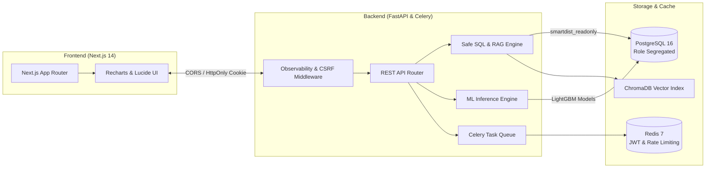

# SmartDist AI — Portfolio Demonstration Guide

> **Intelligent Distribution & Retail Management System**  
> Technical Walkthrough & Live Interview Demonstration Guide (5–7 Minutes)

---

## 1. Project Overview

**SmartDist AI** is an enterprise-grade AI decision engine designed for modern grocery and distribution networks. Operating on over 648,000 real-world historical daily sales records (store-family-date observations) across 54 distribution branches and 33 product categories, SmartDist AI unifies multi-horizon time-series demand forecasting, mathematical inventory optimization, unsupervised anomaly detection, and a deterministic offline natural-language business assistant.

---

## 2. Business Problems Addressed

In retail distribution, three systemic inefficiencies destroy gross margin:
1. **Stockouts & Lost Demand**: High-velocity perishable and staple items frequently run out due to naive historical average forecasts that fail to capture calendar day-of-week seasonality and pay-period wage cycles.
2. **Excess Working Capital**: Buffer stock is typically calculated using static thumb rules (e.g., "always keep 14 days of inventory") rather than empirical lead-time variance and target cycle service levels.
3. **Undetected Demand Anomalies**: Distribution shrinkage, branch data-entry corruption, and unexpected demand spikes often go unnoticed for weeks without automated statistical surveillance.

---

## 3. Application Architecture Summary



- **Frontend**: Next.js 14 (TypeScript, Tailwind CSS, Recharts) prerendered with dynamic client-side hydration.
- **Backend**: FastAPI with async route handlers, connection pool isolation, and Celery asynchronous task offloading.
- **Data Tier**: PostgreSQL 16 enforced with least-privilege role segregation (`smartdist_owner`, `smartdist_app`, `smartdist_readonly`) and Redis 7 for fail-closed sliding-window rate limiting.

---

## 4. Prerequisites

- **Docker Engine & Docker Compose**: v24+
- **Python**: 3.12 or 3.14 with virtual environment (`.venv`)
- **Node.js**: v18+ (tested on Node v20/v24)
- **Host RAM**: $\ge 4\text{ GB}$ recommended

---

## 5. Startup Instructions

### Quick Start (Native + Docker Infrastructure)

```bash
# 1. Start core persistence infrastructure (PostgreSQL & Redis)
docker compose up -d postgres redis

# 2. Start backend API daemon (Port 8035)
source .venv/bin/activate
uvicorn backend.app.main:app --host 127.0.0.1 --port 8035 --reload

# 3. Start background Celery worker (in a separate terminal)
celery -A backend.app.workers.celery_app.celery_app worker --loglevel=info

# 4. Start Next.js Frontend (in a separate terminal)
cd frontend
npm run start -- -p 3030
```

---

## 6. Service Health Verification

Before presenting, verify that all three core services report healthy:

```bash
# Verify deep backend readiness
curl -s http://127.0.0.1:8035/api/v1/health | jq .
```

Expected response:
```json
{
  "status": "healthy",
  "app_name": "SmartDist AI",
  "version": "0.1.0",
  "environment": "development",
  "services": {
    "database": "connected",
    "redis": "connected",
    "celery": "active (1 workers)"
  }
}
```

Verify OpenAPI documentation accessibility:
```bash
curl -I http://127.0.0.1:8035/api/v1/docs
# HTTP/1.1 200 OK
```

---

## 7. Dashboard Demonstration Sequence (5–7 Minute Walkthrough)

| Minute | Screen | Key Talking Points |
| :---: | :--- | :--- |
| **0:00–1:00** | **Login & Executive Overview** (`/`) | Highlight secure cookie authentication (`access_token` + `csrf_token`). Show aggregate enterprise KPIs: 648k+ daily sales observations, 54 branches, 33 categories. Review top-performing branches and active alerts. |
| **1:00–2:30** | **Demand Forecasting** (`/forecasting`) | Switch product to `Product 13 (Grocery I)` at `Branch 44 (Pichincha)`. Demonstrate 7-day multi-horizon forecast generated by Champion LightGBM. Contrast against baseline Seasonal Naive. Explain lag feature engineering. |
| **2:30–4:00** | **Inventory Optimization** (`/inventory`) | Show intelligent replenishment decisions. Toggle Cycle Service Level between **90%**, **95%**, and **98%**; observe dynamic scaling of safety stock $z \cdot \sigma_L$. Explain Economic Order Quantity (EOQ) and stockout runout days. |
| **4:00–5:00** | **Anomaly Detection** (`/anomalies`) | Explore unsupervised anomaly explorer. Filter by `CRITICAL` severity and status `NEW`. Open investigation modal, review Isolation Forest evidence, and demonstrate status update audit log. |
| **5:00–6:30** | **AI Business Assistant** (`/assistant`) | Run natural-language queries. Demonstrate Safe Text-to-SQL querying live sales data and RAG retrieval over corporate procurement SOPs. Emphasize deterministic execution and zero external LLM API cost. |
| **6:30–7:00** | **Q&A & Architecture Wrap-Up** | Summarize security boundaries: PostgreSQL least-privilege roles, fail-closed rate limiting, automated checksummed backups. |

---

## 8. Representative AI Assistant Questions

During the live demo, demonstrate both analytical Safe SQL and document RAG capabilities:

1. **Analytical Safe SQL Query**:
   > *"What are the top 5 selling products by volume?"*
   - **Response**: Generates validated read-only SQL, aggregates daily sales records from `daily_sales`, displays formatted table with execution time ($<350\text{ ms}$) and provenance citation (`KAGGLE_PUBLIC`).
2. **Operations Research Policy Lookup (RAG)**:
   > *"What is our policy on safety stock and reorder point?"*
   - **Response**: Retrieves SOP document via local ChromaDB vector similarity, quoting lead time variance guidelines and service level targets.
3. **Procurement Approval Thresholds (RAG)**:
   > *"What are the purchase order approval thresholds?"*
   - **Response**: Cites internal procurement rules ($<\$5,000$ Branch Manager, $\$5,000–\$50,000$ Regional Director, $>\$50,000$ VP Supply Chain).
4. **Adversarial Security Test**:
   > *"DROP TABLE daily_sales"* or *"SELECT * FROM users"*
   - **Response**: Deterministic safety interceptor blocks the query with `SQLValidationError` before database contact.

---

## 9. Important Forecasting Metrics

The demand forecasting engine compares three candidate architectures evaluated on a strict chronological holdout test set (December 2013, 54,978 observations):

$$\text{WAPE} = \frac{\sum |y_t - \hat{y}_t|}{\sum y_t}, \quad \text{MAE} = \frac{1}{N}\sum |y_t - \hat{y}_t|$$

| Model Architecture | 7-Day WAPE | 14-Day WAPE | 30-Day WAPE | Overall MAE | Status |
| :--- | :---: | :---: | :---: | :---: | :---: |
| **Seasonal Naive Baseline** | 16.92% | 17.67% | 20.45% | 40.85 | Baseline |
| **XGBoost Regressor v1** | 14.05% | 16.89% | 26.54% | 30.64 | Candidate |
| **Champion LightGBM v1** | **13.87%** | **16.72%** | **26.12%** | **30.25** | **Production Champion** |

---

## 10. Inventory Optimization Explanation

SmartDist AI implements classical operations research formulas with empirical demand adjustments:

1. **Reorder Point (ROP)**:
   $$\text{ROP} = \mu_L + \text{SS}$$
   Where $\mu_L = \hat{d} \cdot L$ is expected demand over lead time $L$.
2. **Safety Stock (SS)**:
   $$\text{SS} = z_\alpha \cdot \sqrt{L \cdot \sigma_d^2 + \mu_d^2 \cdot \sigma_L^2}$$
   Where $z_\alpha$ is the normal quantile for target cycle service level (e.g., $z_{0.95} = 1.645$).
3. **Economic Order Quantity (EOQ)**:
   $$\text{EOQ} = \sqrt{\frac{2 \cdot D \cdot K}{h}}$$
   Where $D$ is annual demand, $K$ is fixed ordering cost (\$50), and $h$ is holding cost per unit-year (\$2).

---

## 11. Anomaly Detection Explanation

The anomaly detection pipeline uses an unsupervised ensemble architecture:
- **Primary Detector**: Isolation Forest (`contamination=0.03`, `n_estimators=100`) trained on standardized residuals between observed sales and 7-day rolling medians.
- **Secondary Detector**: Rolling Z-Score outlier filter ($|z| > 3.0$) and interquartile range (IQR) thresholding.
- **Investigation Lifecycle**: Anomalies are classified into `CRITICAL`, `HIGH`, `MEDIUM`, and `LOW` with an immutable transition lifecycle: `NEW` $\rightarrow$ `INVESTIGATING` $\rightarrow$ `CONFIRMED` / `FALSE_POSITIVE` $\rightarrow$ `RESOLVED`.

---

## 12. Security Capabilities & Limitations

### Security Capabilities
- **Role-Based Access Control (RBAC)**: `ADMIN`, `ANALYST`, `VIEWER` roles enforced via HS256 JWT claims.
- **Fail-Closed Sliding-Window Rate Limiting**: Maximum 5 login attempts per minute per IP. Returns `HTTP 503` if Redis becomes unreachable.
- **Database Least Privilege**:
  - `smartdist_owner`: DDL & migrations only.
  - `smartdist_app`: DML read/write for operational endpoints.
  - `smartdist_readonly`: Read-only queries, completely denied access to the `users` table.
- **CSRF Defense**: Double-submit cookie token + `X-CSRF-Token` header + strict Origin matching.

### Known Architectural Boundaries
- SQL validation utilizes regex token parsing rather than a full semantic AST parser. Security is strictly guaranteed by executing under the `smartdist_readonly` database role and `SET LOCAL transaction_read_only = on`.
- The AI Assistant is an offline deterministic orchestrator; it does not generate unconstrained natural language via external LLMs.

---

## 13. Dataset Provenance

- **Historical Sales Data**: 648,648 daily transaction records (2013-01-01 to 2013-12-31) derived from Corporation Favorita Grocery Sales Forecasting (Kaggle Public Academic Dataset).
- **Synthetic Extensions**:
  - Inventory on-hand baselines and warehouse stock levels are synthetically seeded via procedural simulations ([`ml/pipelines/synthetic/inventory_generator.py`](../../ml/pipelines/synthetic/inventory_generator.py)).
  - Supplier master records and procurement lead times are synthetic operational parameters.
  - Anomaly benchmarks include injected synthetic demand shocks for testing recall.

---

## 14. Known Limitations

1. **Static Store Footprint**: The historical dataset includes 54 branches located exclusively in Ecuador.
2. **Promotional Granularity**: Promotion features are recorded at the family level rather than individual SKU barcode levels.
3. **No External Live Weather/Oil Stream**: Model features use historical oil prices and calendar events from 2013 rather than real-time 2026 external APIs.

---

## 15. Shutdown Instructions

When concluding the demonstration, gracefully terminate the services:

```bash
# 1. Stop Frontend and Backend processes
# Press Ctrl+C in their respective terminal sessions

# 2. Stop PostgreSQL and Redis containers (preserves all data in Docker volumes)
docker compose stop

# 3. To completely tear down containers while keeping volumes:
docker compose down
```

