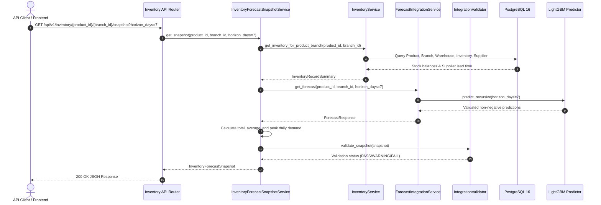

# SmartDist AI — Inventory Data & Forecast Integration Architecture
## Technical Specification, Service Interaction & Snapshot Schemas

**Author**: Senior Machine Learning Engineer & Backend Architect  
**Subphase**: Phase 3.3.1 Inventory Data & Forecast Integration  
**Date**: November 9, 2026  
**Status**: VERIFIED & DEPLOYED  

---

## 1. System Overview

Phase 3.3.1 creates the operational integration layer between physical warehouse inventory balances, master catalog hierarchies, supplier procurement constraints, and machine learning demand forecasts.

This service foundation enables downstream inventory optimization modules (Phase 3.3.2: Safety Stock, Reorder Point, and Economic Order Quantity calculation) to consume unified, validated snapshots without directly orchestrating complex ML pipelines or database joins.

---

## 2. Core Integration Services

### 2.1 `InventoryService` (`backend/app/services/inventory_service.py`)
- **Responsibility**: Manages physical warehouse balances, allocated/reserved customer units, and supplier procurement terms.
- **Stock Calculations**:
  $$\text{available\_stock} = \text{current\_stock} - \text{reserved\_stock}$$
- **Operational Invariants Enforced**:
  - `current_stock >= 0`: Non-negative inventory balance.
  - `reserved_stock >= 0`: Non-negative allocation.
  - `reserved_stock <= current_stock`: Allocated inventory cannot exceed physical warehouse stock.
  - Supplier lookup: Identifies the active supplier offering the lowest unit purchasing cost.
  - Unrecorded inventory: If a retail branch does not possess a direct regional warehouse mapping, current stock returns `None` and is flagged as `MISSING_INVENTORY` rather than fabricated.

### 2.2 `ForecastIntegrationService` (`backend/app/services/forecast_service.py`)
- **Responsibility**: Bridges the REST layer to the serialized LightGBM champion artifact (`ml/artifacts/lightgbm_v1.joblib`).
- **Forecasting Execution**:
  - Reuses [ForecastingPredictor](file:///home/zarr/Documents/smartdist-ai/ml/inference/predictor.py) for recursive multi-step forecasting across 7-day, 14-day, and 30-day horizons.
  - Strictly guarantees zero future lookahead bias by updating autoregressive lags using model predictions $\hat{y}$.
  - Excludes unobserved contemporaneous foot-traffic (`transactions`).
  - Distinguishes unobserved historical series (`status="UNAVAILABLE"`) from genuine zero-demand forecast outputs (`status="ZERO_DEMAND"`).
  - Validates predictions against NaN, infinite, or invalid negative numbers.

### 2.3 `InventoryForecastSnapshotService` (`backend/app/services/snapshot_service.py`)
- **Responsibility**: Unifies inventory balances with forward demand predictions into a consolidated snapshot.
- **Aggregated Metrics**:
  $$\text{total\_forecast\_demand} = \sum_{t=1}^{H} \hat{y}_t$$
  $$\text{average\_daily\_demand} = \frac{\text{total\_forecast\_demand}}{H}$$
  $$\text{peak\_daily\_demand} = \max_{t \in [1, H]} \hat{y}_t$$
- **Traceability & Provenance**:
  - Sales data origin: `KAGGLE_PUBLIC`
  - Inventory data origin: `SYNTHETIC`
  - Model metadata: `lightgbm` version `v1`

### 2.4 `IntegrationValidator` (`backend/app/services/integration_validator.py`)
- **Responsibility**: Automated quality assurance and data health checks.
- **Check Dimensions**:
  1. `inventory_record_existence`: Verifies physical warehouse records exist for the queried entity.
  2. `physical_stock_non_negative`: Verifies on-hand stock is non-negative.
  3. `reserved_le_current_stock`: Flags allocations exceeding on-hand stock.
  4. `supplier_assignment` & `supplier_lead_time_validity`: Validates procurement supplier existence and positive lead times.
  5. `forecast_availability` & `forecast_horizon_completeness`: Ensures daily forecast record count equals requested horizon.
  6. `forecast_non_negative`: Guarantees zero negative demand outputs.
  7. `inventory_uniqueness`: Verifies zero duplicate records across `(product_id, warehouse_id)`.
  8. `inventory_freshness`: Monitors inventory balance timestamps against stale thresholds.

---

## 3. API Endpoints Specification

| Method | Endpoint | Description | Query Parameters |
| :--- | :--- | :--- | :--- |
| `GET` | `/api/v1/inventory/forecast-summary` | Overview of inventory balances paired with 7d, 14d, and 30d forecast totals. | `page`, `size`, `branch_id`, `product_id` |
| `GET` | `/api/v1/inventory/{product_id}/{branch_id}/forecast` | Retrieve daily forward demand predictions for a product and branch. | `horizon_days` (7, 14, 30) |
| `GET` | `/api/v1/inventory/{product_id}/{branch_id}/snapshot` | Retrieve consolidated snapshot of inventory, supplier lead time, and forecast metrics. | `horizon_days` (7, 14, 30) |
| `POST` | `/api/v1/inventory/validate-integration` | Trigger automated integration quality validation across the catalog and facilities. | `product_id`, `branch_id`, `sample_limit` |

---

## 4. Synthetic Data Disclosure

- **Sales Demand Records**: Ground truth historical demand observations imported from the Kaggle Store Sales benchmark (`data_origin = 'KAGGLE_PUBLIC'`).
- **Inventory & Suppliers**: Regional distribution centers, suppliers, and stock levels generated reproducibly with fixed random seed (`data_origin = 'SYNTHETIC'`).
- **Operational Reality**: In current synthetic setup, 4 regional distribution hubs (Quito, Guayaquil, Cuenca, Ambato) hold master inventory for branches 1, 24, 37, 50. Queries for storefronts without direct warehouse mappings truthfully return `current_stock = None` and warning status without fabricating synthetic balances.
