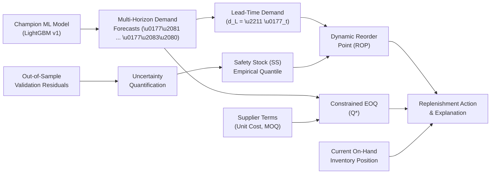

# SmartDist AI — Inventory Optimization Mathematical Foundations & Formulas

## 1. Executive Summary & Optimization Philosophy

In traditional enterprise resource planning (ERP) environments, inventory replenishment relies on static, rule-of-thumb heuristics—such as fixed min-max thresholds or average historical sales multipliers. These static approaches fail under real-world demand non-stationarity, seasonal fluctuations, and supplier lead-time uncertainties, causing simultaneous capital misallocation: overstocking slow movers while incurring stockouts on high-demand items.

**SmartDist AI** replaces static heuristics with a closed-loop, data-driven optimization engine. By pairing high-capacity machine learning demand forecasting (LightGBM) with statistical uncertainty quantification, out-of-sample residual bootstrap simulation, and constrained Economic Order Quantity (EOQ) batching, SmartDist AI delivers mathematically rigorous and human-auditable replenishment decisions.



---

## 2. Mathematical Definitions & Analytical Formulations

### 2.1 Lead-Time Expected Demand ($d_L$)

For an item with a supplier replenishment lead time of $L$ calendar days, the cumulative expected demand over the lead-time replenishment window $[1, L]$ is defined as:

$$d_L = \sum_{t=1}^{L} \hat{y}_t$$

Where:
- $L \in \{1, 2, \dots, 30\}$ is the supplier lead time in days.
- $\hat{y}_t$ is the point forecast for day $t$ generated by the champion demand forecasting model (LightGBM).

*Boundary conditions:* If $L$ exceeds the precomputed forecast sequence length $K$, the remaining $(L - K)$ days are extrapolated using the forward mean daily forecast:
$$d_L = \sum_{t=1}^K \hat{y}_t + (L - K) \times \left(\frac{1}{K}\sum_{t=1}^K \hat{y}_t\right)$$

---

### 2.2 Forecast Error Residuals & Uncertainty Modeling

To prevent catastrophic overfitting and optimistic bias, **SmartDist AI strictly uses genuine out-of-sample forecast residuals**, never in-sample training residuals.

For each validation observation $i$ in the out-of-sample validation partition (November 2013, $N = 53,460$):

$$e_i = y_i - \hat{y}_i$$

Where:
- $y_i$ is the actual observed daily sales volume (`quantity_sold`).
- $\hat{y}_i$ is the model prediction.
- A positive error ($e_i > 0$) represents an **under-forecast** (actual demand exceeded expectations, creating stockout pressure).
- A negative error ($e_i < 0$) represents an **over-forecast** (demand was lower than predicted).

---

### 2.3 Cumulative Lead-Time Error ($E_L$) & Empirical Quantile Safety Stock ($SS$)

In inventory theory, safety stock must buffer against the uncertainty of demand accumulated over the entire supplier lead time $L$. For an item with lead time $L$ calendar days, the cumulative forecast error is:

$$E_L = \sum_{t=1}^{L} (A_t - F_t) = \sum_{t=1}^L e_t$$

Where:
- $A_t$ is actual observed customer demand.
- $F_t = \hat{y}_t$ is model forecast demand.
- $E_L$ is cumulative lead-time forecast error.

Empirical safety stock is derived directly from the $\alpha$-quantile of the cumulative lead-time error distribution:

$$SS_{\text{empirical}} = \max\left(0, Q_\alpha(E_L)\right)$$

For a 95% cycle service level target ($\alpha = 0.95$):
$$SS = \max\left(0, Q_{0.95}(E_L)\right)$$

> [!IMPORTANT]
> **Why Multiplying a 1-Day Quantile by $\sqrt{L}$ is Mathematically Flawed:**
> Quantiles are not linear operators ($Q_\alpha(X_1 + \dots + X_L) \ne Q_\alpha(X) \times \sqrt{L}$). In addition, daily demand errors exhibit substantial temporal autocorrelation ($\bar{\rho}_1 \approx +0.35$ in Store Sales validation data). Positive autocorrelation causes cumulative errors to compound significantly faster than $\sqrt{L}$. SmartDist AI's empirical evaluation over rolling lead-time sums $E_L$ captures autocorrelation, non-normality, and heteroskedasticity directly without distributional assumptions.

#### Hierarchical Evaluation Framework:
To guarantee statistical significance while maximizing series-specific precision, SmartDist AI applies a 5-level hierarchical fallback ($N_{\text{min}} = 20$):
1. **Level 1 (Series-Specific):** Rolling $L$-day cumulative error sum for specific `(store_nbr, product_id)`. Active when series sample size $N \ge 20$.
2. **Level 2 (Product-Pooled):** Rolling $L$-day cumulative errors pooled across all 54 branches for `product_id`. Active when series $N < 20$ (e.g. for longer lead times $L \ge 12$).
3. **Level 3 (Family-Pooled):** Rolling $L$-day cumulative errors pooled across all products within the product family.
4. **Level 4 (Parametric with Autocorrelation VIF Correction):**
   Estimates residual standard deviation $\sigma_e$ (distinguished from RMSE), mean bias $\mu_e = \bar{e}$, and within-series lag-1 autocorrelation $\rho$. Computes the exact AR(1) cumulative error variance and Variance Inflation Factor:
   $$\text{Var}(E_L) = \sigma_e^2 \left(L + 2 \sum_{k=1}^{L-1} (L - k) \rho^k\right) = \sigma_e^2 \cdot L \cdot \text{VIF}(L, \rho)$$
   $$\text{VIF}(L, \rho) = \max\left(1.0, 1 + \frac{2}{L} \sum_{k=1}^{L-1} (L - k) \rho^k\right)$$
   $$Q_\alpha(E_L) \approx L \mu_e + Z_\alpha \sqrt{\text{Var}(E_L)}$$
   $$SS_{\text{parametric}} = \max\left(0.0, L \mu_e + Z_\alpha \sqrt{\text{Var}(E_L)}\right)$$
   *(Note: Empirical cumulative quantiles $Q_\alpha(E_L)$ already incorporate observed forecast bias and must never have $L\mu_e$ added a second time; only the zero-centered normal term $Z_\alpha\sqrt{\text{Var}(E_L)}$ adds $L\mu_e$ once.)*
5. **Level 5 (Insufficient Data):** Returns explicit `INSUFFICIENT_DATA` status if fewer than 2 finite validation residuals are available (never falling back to global RMSE).

---

### 2.4 Dynamic Reorder Point ($ROP$)

The dynamic reorder point establishes the operational inventory threshold below which a purchase order must be placed immediately:

$$ROP = d_L + SS$$

$$\text{Rounded } ROP = \lceil ROP \rceil$$

The operational status is evaluated relative to the current on-hand available stock ($I_{\text{avail}} = I_{\text{physical}} - I_{\text{reserved}}$):

$$\text{Status} = \begin{cases} 
\text{HEALTHY} & \text{if } I_{\text{avail}} > \lceil ROP \rceil \\ 
\text{REORDER\_NOW} & \text{if } \lceil SS \rceil < I_{\text{avail}} \le \lceil ROP \rceil \\ 
\text{URGENT\_REORDER} & \text{if } I_{\text{avail}} \le \lceil SS \rceil \\ 
\text{INSUFFICIENT\_DATA} & \text{if } I_{\text{avail}} \text{ is undefined}
\end{cases}$$

---

### 2.5 Monte Carlo Stockout Risk & Shortage Event Definition

A stockout is defined strictly by the presence of unfulfilled customer demand (shortage). On each simulated day $t \in [1, L]$:

$$\text{Shortage}_t = \max\left(0.0, D_t - I_t^{\text{start}}\right)$$
$$I_t^{\text{end}} = \max\left(0.0, I_t^{\text{start}} - D_t\right)$$

> [!NOTE]
> **Exact Inventory Exhaustion is NOT a Stockout:**
> If available stock is 100 units and customer demand is exactly 100 units, all demand is fulfilled ($\text{Shortage}_t = 0$), ending stock is 0, and no stockout occurs. A stockout occurs if and only if $\text{Shortage}_t > 0$.

The Monte Carlo simulation generates $M = 1,000$ scenarios using **Contiguous Block Bootstrap** sampling to preserve autocorrelation and daily shock sequences:

$$P(\text{stockout}) = \frac{1}{M}\sum_{m=1}^{M} \mathbb{I}\left(\sum_{t=1}^L \text{Shortage}_t^{(m)} > 0\right)$$

#### Risk Categorization:
- **LOW:** $P(\text{stockout}) \le 0.10$
- **MEDIUM:** $0.10 < P(\text{stockout}) \le 0.30$
- **HIGH:** $0.30 < P(\text{stockout}) \le 0.60$
- **CRITICAL:** $P(\text{stockout}) > 0.60$ (or unassigned/missing inventory)

---

### 2.6 Economic Order Quantity (EOQ) with Constraints

The theoretical unconstrained Economic Order Quantity minimizes annual ordering and inventory carrying costs:

$$EOQ_{\text{raw}} = \sqrt{\frac{2 D S}{H}}$$

Where:
- $D = \bar{d}_{\text{30d}} \times 365$ is the annualized forward demand run-rate (units/year).
- $S$ is procurement administrative cost per purchase order (\$/order, default $S = \$50.00$, marked as configurable planning parameter).
- $c$ is unit purchase cost (\$/unit, sourced from supplier master table).
- $h$ is annual holding cost percentage rate (default $h = 0.20$, marked as configurable planning parameter).
- $H = c \times h$ is annual holding cost per unit stored (\$/unit/year).

#### Commercial Adjustments & Dimensional Consistency:
- **Dimensions:** $\sqrt{\frac{2 \times (\text{units/year}) \times (\$ / \text{order})}{(\$ / \text{unit/year})}} = \text{units}$ (strictly dimensionally consistent).
- **Supplier MOQ Adjustment:** $Q_1 = \max(\lceil EOQ_{\text{raw}} \rceil, MOQ)$
- **Carton/Pallet Multiple Adjustment:** $Q^* = \lceil Q_1 / M_{\text{pack}} \rceil \times M_{\text{pack}}$
- $D = \bar{d}_{\text{daily}} \times 365$ is the annualized demand rate.
- $S$ is the fixed procurement administrative cost per purchase order (default $S = \$50.00$).
- $c$ is the unit purchase cost from the supplier.
- $h$ is the annual holding cost percentage rate (default $h = 0.20$, or 20% of unit cost).
- $H = c \times h$ is the annual holding cost per unit stored.

#### Commercial Supplier Adjustments:
In enterprise procurement, orders must comply with supplier minimum order quantities ($MOQ$) and integer packaging multiples ($M_{\text{pack}}$, e.g., master cartons of 12 or pallets of 50):

$$Q_1 = \max\left(\lceil EOQ_{\text{raw}} \rceil, MOQ\right)$$

$$Q^* = \left\lceil \frac{Q_1}{M_{\text{pack}}} \right\rceil \times M_{\text{pack}}$$

Where $Q^*$ is the final recommended order quantity.

#### Total Modeled Inventory Cost ($TC$):
$$TC(Q) = \left(\frac{D}{Q}\right)S + \left(\frac{Q}{2}\right)H$$

At the unconstrained minimum $EOQ_{\text{raw}}$, annual ordering cost equals annual holding cost:
$$\left(\frac{D}{EOQ}\right)S = \left(\frac{EOQ}{2}\right)H = \sqrt{\frac{D S H}{2}}$$

---

### 2.7 Replenishment Order-Up-To Target

When an order is triggered ($I_{\text{avail}} \le ROP$), the recommended order quantity is calculated using an order-up-to policy:

$$S_{\text{target}} = ROP + Q^*$$

$$Q_{\text{order}} = \max\left(Q^*, \lceil S_{\text{target}} - I_{\text{avail}} \rceil\right)$$

Subject to supplier packaging multiples:
$$Q_{\text{order, final}} = \left\lceil \frac{Q_{\text{order}}}{M_{\text{pack}}} \right\rceil \times M_{\text{pack}}$$

---

## 3. Discrete-Time Inventory Policy Simulation

To prove policy superiority before live warehouse deployment, the simulation engine performs a daily, discrete-time backtest without lookahead bias.

```mermaid
sequenceDiagram
    autonumber
    participant Day as Daily Clock (Day t)
    participant Pipeline as Supplier Inbound Pipeline
    participant Stock as On-Hand Stock (I_t)
    participant Demand as Customer Demand (D_t)
    participant Policy as Policy Decision Engine

    Day->>Pipeline: Check for deliveries due at day t
    Pipeline->>Stock: Add arrived orders: I_t = I_{t-1} + Q_arrived
    Day->>Demand: Observe customer demand D_t
    Demand->>Stock: Fulfill demand: Met = min(I_t, D_t), Unmet = D_t - Met
    Stock->>Stock: Update physical stock: I_t = max(0, I_t - D_t)
    Day->>Policy: Inspect inventory position (I_t + Inbound)
    alt Position <= ROP
        Policy->>Pipeline: Place PO of size Q; Arrival scheduled for t + L
    else Position > ROP
        Policy->>Pipeline: No order placed
    end
```

### Key Performance Indicators (KPIs)
1. **Fill Rate ($\%$):**
   $$\text{Fill Rate} = \frac{\sum_{t=1}^T \text{Fulfilled Demand}_t}{\sum_{t=1}^T D_t} \times 100\%$$

2. **Stockout Days:**
   $$\text{Stockout Days} = \sum_{t=1}^T \mathbb{I}\left(D_t > 0 \text{ and } I_t^{\text{start}} = 0\right)$$

3. **Average Inventory:**
   $$\bar{I} = \frac{1}{T}\sum_{t=1}^T I_t^{\text{end}}$$

4. **Inventory Turnover Ratio:**
   $$\text{Turnover} = \frac{\text{Annualized Fulfilled Volume}}{\bar{I}} = \frac{\left(\sum_{t=1}^T \text{Fulfilled}_t\right) \times (365 / T)}{\bar{I}}$$

5. **Total Simulated Cost:**
   $$C_{\text{total}} = N_{\text{orders}} \times S + \left(\sum_{t=1}^T I_t \times \frac{H}{365}\right) + \sum_{t=1}^T \text{Unmet}_t \times C_{\text{penalty}}$$

---

## 4. Worked Numerical Examples for Inventory Managers

### Example 1: Automotive SKU (Store #1, Product #1)
- **Supplier Lead Time ($L$):** 5 days
- **Daily Forecasts ($\hat{y}_1 \dots \hat{y}_5$):** $[1.98, 1.95, 2.01, 1.97, 1.98]$ units/day
- **Expected Lead-Time Demand ($d_L$):**
  $$d_L = 1.98 + 1.95 + 2.01 + 1.97 + 1.98 = 9.89 \text{ units}$$
- **Out-of-sample cumulative 5-day error 95th percentile ($Q_{0.95}(E_5)$):** $5.36$ units ($N = 26$ rolling 5-day validation windows)
- **Safety Stock ($SS$):**
  $$SS = \max(0, Q_{0.95}(E_5)) = 5.36 \text{ units} \implies \lceil 5.36 \rceil = 6 \text{ units}$$
- **Reorder Point ($ROP$):**
  $$ROP = 9.89 + 5.36 = 15.25 \text{ units} \implies \lceil 15.25 \rceil = 16 \text{ units}$$
- **Annualized Demand ($D$):** $2.41 \times 365 = 880.08 \text{ units/year}$
- **Unit Cost ($c$):** $\$16.56$, **Holding Rate ($h$):** $0.20 \implies H = \$3.312/\text{unit/year}$
- **Ordering Cost ($S$):** $\$50.00$
- **Raw EOQ:**
  $$EOQ = \sqrt{\frac{2 \times 880.08 \times 50}{3.312}} = \sqrt{26,572.46} = 163.01 \text{ units}$$
- **Supplier Constraints:** MOQ = 100, Multiple = 1
- **Adjusted EOQ ($Q^*$):** $164 \text{ units}$
- **Current On-Hand Stock:** 156 units available (210 physical, 54 reserved)
- **Decision:** $156 > 16 \implies \mathbf{NO\_ACTION}$ (Inventory position is healthy; 0% stockout risk).

---

### Example 2: Fast-Moving Grocery SKU under Stockout Pressure
- **Supplier Lead Time ($L$):** 3 days
- **Daily Forecast:** $120.0 \text{ units/day} \implies d_L = 360.0 \text{ units}$
- **Safety Stock (95% service level):** $45.0 \text{ units}$
- **Reorder Point ($ROP$):** $360 + 45 = 405 \text{ units}$
- **Current Available Stock:** $30 \text{ units}$
- **Stockout Analysis:**
  $$I_{\text{avail}} (30) \le SS (45) \implies \mathbf{URGENT\_REORDER}$$
  Monte Carlo simulation reveals stock will be exhausted on Day 1 ($P(\text{stockout}) = 98.4\%$, **CRITICAL** risk).
- **EOQ Calculation ($D = 43,800$, $S = \$50$, $c = \$3.50$, $H = \$0.70$):**
  $$EOQ_{\text{raw}} = \sqrt{\frac{2 \times 43800 \times 50}{0.70}} = \sqrt{6,257,142} \approx 2,501 \text{ units}$$
- **Supplier Constraints:** Packaging multiple = 50 units $\implies Q^* = 2,550 \text{ units}$
- **Target Stock ($S_{\text{target}}$):** $405 + 2550 = 2,955 \text{ units}$
- **Order Quantity:** $2,955 - 30 = 2,925 \text{ units} \implies 59 \text{ cartons of 50} = \mathbf{2,950 \text{ units}}$.
- **Human-Auditable Explanation:**
  > *"CRITICAL ACTION REQUIRED: Immediate PO of 2,950 units recommended for supplier. Available stock (30 units) has breached safety threshold (45 units) with 98.4% simulated stockout probability before 3-day lead-time delivery."*
