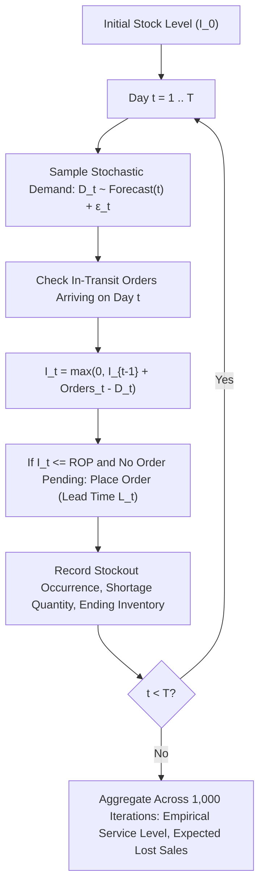

# SmartDist AI — Stockout Risk & Runout Modeling

This document details the stockout risk estimation, days-of-supply (runout), and Monte Carlo inventory simulation engines in SmartDist AI.

---

## 1. Runout Days (Days of Supply) Formulation

Runout days estimate the operational time before an SKU exhausts its available on-hand stock under current forecast velocity:

$$\text{Runout Days} = \frac{I_{\text{on\_hand}}}{\bar{D}_{\text{forecast}}}$$

Where:
- $I_{\text{on\_hand}}$ is current usable warehouse inventory.
- $\bar{D}_{\text{forecast}}$ is the daily mean forecasted demand over the upcoming planning horizon (7, 14, or 30 days).

---

## 2. Stockout Risk Classification

SmartDist AI assigns real-time stockout risk tiers based on the ratio between Runout Days and Supplier Lead Time ($L$):

| Risk Tier | Condition | Operational Trigger & Action |
| :--- | :--- | :--- |
| **CRITICAL** | $\text{Runout Days} \le 0.5 \times L$ or $I_{\text{on\_hand}} \le 0$ | Immediate emergency supplier PO dispatch; expedited freight alert. |
| **HIGH** | $0.5 \times L < \text{Runout Days} \le 1.0 \times L$ | Trigger automated Reorder Point ($ROP$) replenishment notification. |
| **MEDIUM** | $1.0 \times L < \text{Runout Days} \le 1.5 \times L$ | Planned replenishment within normal procurement cycle. |
| **LOW** | $\text{Runout Days} > 1.5 \times L$ | Adequate safety cushion; no immediate reorder required. |

---

## 3. Monte Carlo Inventory Simulation

Implemented in `backend/app/services/simulation_service.py`, the Monte Carlo engine simulates inventory trajectories over a 30-to-90 day forward window to evaluate service-level resilience under joint demand and lead-time stochasticity:

### Simulation Outputs
1. **Empirical Fill Rate:** Fraction of customer demand satisfied directly from on-hand inventory.
2. **Probability of Stockout ($P_{\text{stockout}}$):** Percentage of simulation runs experiencing one or more stockout events.
3. **Expected Units Short:** Mean volume of lost or backordered sales per planning horizon.

