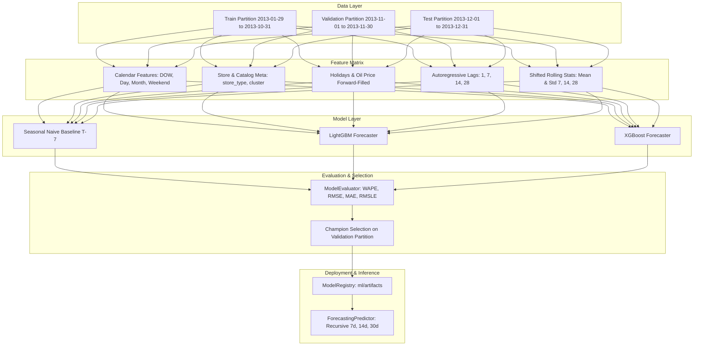

# SmartDist AI — Demand Forecasting Architecture
## Machine Learning System Architecture & Design Specification

**Module**: `ml/`  
**Phase**: 3.2 Demand Forecasting Model Development  
**Target Variable**: `quantity_sold` (Continuous daily sales units)

---

## 1. Architectural Philosophy

SmartDist AI employs a **global multi-series forecasting architecture**. Instead of fitting 1,782 isolated local univariate models for every individual store-product combination, the system trains global gradient boosted decision tree (GBDT) ensembles across all series simultaneously.

### Key Advantages:
1. **Cross-Series Learning**: Enables the model to learn shared seasonal patterns, holiday impact elasticities, and promotional response functions across stores and product families.
2. **Cold Start & New Entity Support**: Any store or product with static categorical metadata (`store_type`, `store_cluster`, `family`) can be forecast immediately.
3. **Operational Maintainability**: Managing a single champion model artifact is orders of magnitude simpler and more scalable than orchestrating thousands of individual ARIMA/Prophet models in production.

---

## 2. Component Structure



---

## 3. Class Hierarchy & Contract

All forecasting models adhere to `BaseForecaster` (`ml/models/base.py`):

```python
class BaseForecaster(ABC):
    def fit(self, X: pd.DataFrame, y: pd.Series, val_X=None, val_y=None, **kwargs) -> "BaseForecaster": ...
    def predict(self, X: pd.DataFrame) -> np.ndarray: ...
    def save(self, filepath: Union[str, Path]) -> None: ...
    def load(cls, filepath: Union[str, Path]) -> "BaseForecaster": ...
```

### Models Implemented:
1. **`SeasonalNaiveForecaster`** (`ml/models/seasonal_naive.py`):
   - Non-parametric weekly seasonal baseline predicting $\hat{y}(t) = y(t - 7)$ per `(store_nbr, product_id)`.
2. **`LightGBMForecaster`** (`ml/models/lightgbm_model.py`):
   - Fast histogram-based GBDT regressor with native categorical support and early stopping.
3. **`XGBoostForecaster`** (`ml/models/xgboost_model.py`):
   - GBDT regressor with `tree_method="hist"` and `enable_categorical=True`.

---

## 4. Multi-Step Recursive Forecasting Protocol

In operational retail planning, businesses require forward-looking horizons:
- **7-Day Horizon**: Short-term warehouse replenishment.
- **14-Day Horizon**: Distribution center scheduling.
- **30-Day Horizon**: Monthly purchasing and supplier orders.

The `ForecastingPredictor` (`ml/inference/predictor.py`) implements strict recursive multi-step forecasting:
1. Forecasts date $T_0 + 1$ using historical observations.
2. Feeds the predicted demand $\hat{y}_{T_0 + 1}$ back into `lag_1` and rolling window statistics for predicting date $T_0 + 2$.
3. Continues step-by-step up to $T_0 + H$.
4. **Guarantees zero future-target leakage**: True observed demand values for dates $> T_0$ are never accessed.
