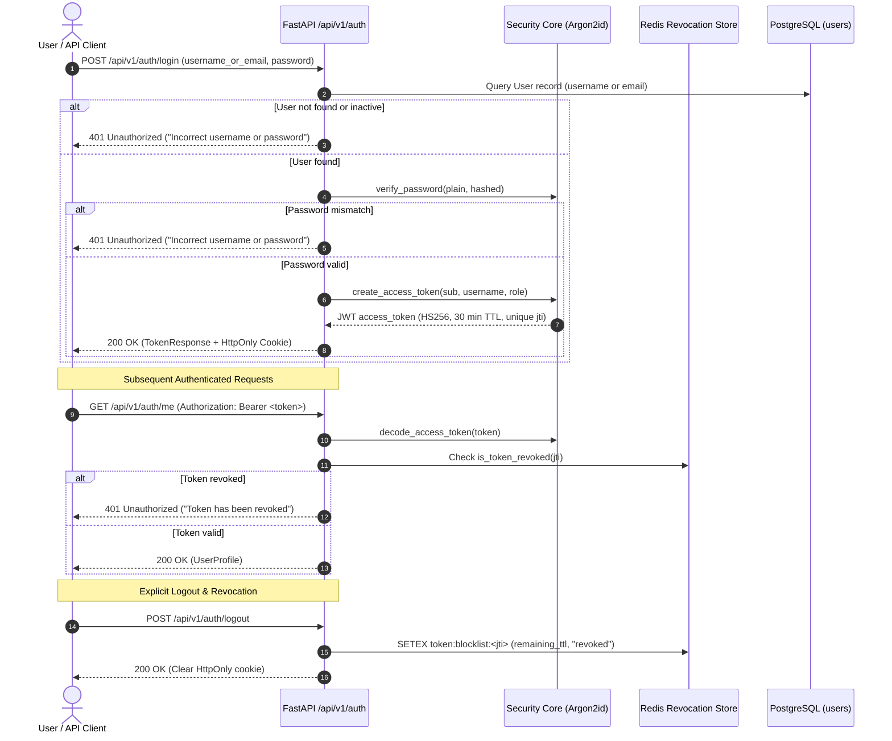

# SmartDist AI — Phase 5.1: Authentication & Role-Based Access Control (RBAC)

> **Document Status**: Production Security Architecture Guide  
> **Milestone**: Phase 5.1 — Security Foundation  
> **Target Date**: November 2026  
> **Repository**: `~/Documents/smartdist-ai`  

---

## 1. Authentication Architecture

SmartDist AI implements a defense-in-depth authentication layer designed for high-assurance enterprise distribution and retail analytics.



### 1.1 Password Hashing (Argon2id)
- **Algorithm**: Argon2id via `argon2-cffi` library.
- **Cryptographic Parameters (RFC 9106)**:
  - `time_cost`: 3 iterations
  - `memory_cost`: 65,536 KiB (64 MiB)
  - `parallelism`: 4 lanes
  - `hash_len`: 32 bytes
  - `salt_len`: 16 bytes
- **Anti-Enumeration Guarantee**: Both non-existent users and password mismatches return identical HTTP `401 Unauthorized` with body `{"detail": "Incorrect username or password"}`.

### 1.2 JWT Access Tokens & Explicit Revocation
- **Signing Algorithm**: HMAC-SHA256 (`HS256`).
- **Secret Key**: Sourced strictly from environment variable `SECRET_KEY` (minimum 256 bits).
- **Default Lifetime**: 30 minutes (`ACCESS_TOKEN_EXPIRE_MINUTES = 30`).
- **Standard Claims**:
  - `sub`: User ID (integer as string).
  - `username`: Operator handle.
  - `role`: Role string (`ADMIN`, `ANALYST`, or `VIEWER`).
  - `jti`: Universally unique identifier (UUIDv4) for per-token tracking.
  - `iat`: Timestamp of issue.
  - `exp`: Timestamp of expiration.
- **Revocation Blocklist**:
  - Stateless JWTs technically remain mathematically valid until expiration.
  - Upon calling `POST /api/v1/auth/logout`, the server extracts the `jti` and registers `token:blocklist:<jti>` into Redis with a TTL equal to the token's remaining lifespan.
  - The `get_current_user` dependency verifies that `is_token_revoked(jti)` is false before granting endpoint access.

### 1.3 Dual-Channel Token Delivery & CSRF Defense
1. **Programmatic / API Consumers**:
   - Access token returned in JSON response body (`access_token`).
   - Consumer transmits via `Authorization: Bearer <token>`.
2. **Browser Sessions (Next.js Dashboard)**:
   - Server sets an `HttpOnly`, `SameSite=Lax`, `Path=/` cookie named `access_token`.
   - In production or HTTPS environments, `Secure=True` is enforced.
   - **CSRF Defense**: All mutating requests (`POST`, `PUT`, `PATCH`, `DELETE`) require the `X-Requested-With: XMLHttpRequest` header. Browsers prevent unauthorized cross-origin sites from injecting custom request headers without preflight approval.

---

## 2. Role-Based Access Control (RBAC)

### 2.1 Role Definitions

| Role | Scope | Permitted Actions | Forbidden Actions |
|---|---|---|---|
| **`ADMIN`** | System Administration & All Analytics | User provisioning, role management, activating/deactivating accounts, running ETL/anomaly jobs, viewing all dashboards, generating forecasts, executing Safe Text-to-SQL. | Direct raw unconstrained DDL/DML; SQL injection attempts. |
| **`ANALYST`** | Quantitative Planning & Operations | Viewing sales trends and branch performance, generating LightGBM forecasts, calculating inventory ROP/SS/EOQ, triaging sales anomalies, executing Safe Text-to-SQL, running AI Assistant workflows. | Accessing `/api/v1/users`, modifying user roles, executing DDL. |
| **`VIEWER`** | Operational Oversight (Read-Only) | Reading executive KPI cards, daily sales trends, inventory monitoring levels, and anomaly lists. | Modifying anomaly statuses (`PATCH /anomalies/{id}/status`), executing custom SQL, running triage workflows, modifying any state. |

### 2.2 FastAPI Dependency Enforcement

Permission enforcement is executed in the backend dependency injection graph rather than relying on frontend UI state:

```python
# backend/app/api/deps.py

class RoleChecker:
    def __init__(self, allowed_roles: List[UserRole]):
        self.allowed_roles = allowed_roles

    def __call__(self, current_user: User = Depends(get_current_active_user)) -> User:
        if current_user.role not in self.allowed_roles:
            raise HTTPException(
                status_code=status.HTTP_403_FORBIDDEN,
                detail=f"Forbidden: Insufficient privileges. Required role in {[r.value for r in self.allowed_roles]}",
            )
        return current_user

require_admin = RoleChecker([UserRole.ADMIN])
require_analyst = RoleChecker([UserRole.ADMIN, UserRole.ANALYST])
require_viewer = RoleChecker([UserRole.ADMIN, UserRole.ANALYST, UserRole.VIEWER])
```

---

## 3. User Management APIs (ADMIN Only)

- `GET /api/v1/users`: List all system accounts.
- `POST /api/v1/users`: Provision a new user account with designated role.
- `GET /api/v1/users/{id}`: Inspect specific user record.
- `PUT /api/v1/users/{id}`: Update user email, full name, role, or password.
- `PATCH /api/v1/users/{id}/status`: Enable or disable an account (`is_active: bool`). Self-deactivation by the operating admin is explicitly rejected.

