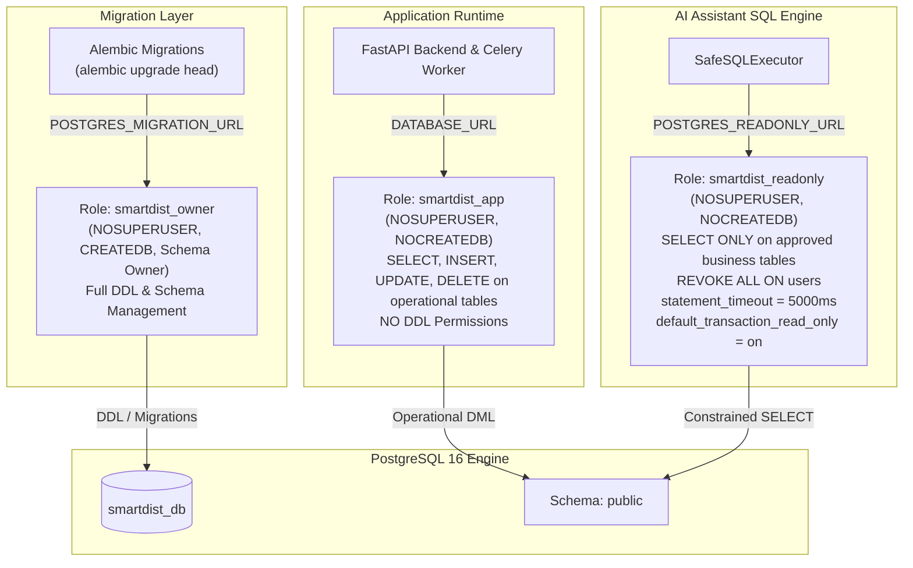

# SmartDist AI — Phase 5.1: Database Least Privilege & Role Separation

> **Document Status**: Production Database Security Architecture Guide  
> **Milestone**: Phase 5.1 — Security Foundation  
> **Target Date**: November 2026  
> **Repository**: `~/Documents/smartdist-ai`  

---

## 1. Least-Privilege Role Hierarchy

Prior to Phase 5.1, the application executed all database tasks (schema migrations, operational REST requests, and user-initiated Text-to-SQL queries) under a single schema owner role (`smartdist_user`). 

Phase 5.1 establishes a strict **three-tier least-privilege role separation**:



---

## 2. Role Specifications & Privileges

### 2.1 `smartdist_owner` (Migration / Schema Authority)
- **Privilege Scope**: Database owner (`NOSUPERUSER`).
- **Target Use**: Used exclusively by Alembic for schema migrations and data seeding scripts.
- **Grants & Default Privileges**:
  ```sql
  CREATE ROLE smartdist_owner WITH LOGIN PASSWORD '***' NOSUPERUSER CREATEDB;
  ALTER DATABASE smartdist_db OWNER TO smartdist_owner;

  -- Ensure future tables created by owner automatically grant DML to runtime
  ALTER DEFAULT PRIVILEGES FOR ROLE smartdist_owner IN SCHEMA public 
      GRANT SELECT, INSERT, UPDATE, DELETE ON TABLES TO smartdist_app;

  ALTER DEFAULT PRIVILEGES FOR ROLE smartdist_owner IN SCHEMA public 
      GRANT USAGE, SELECT ON SEQUENCES TO smartdist_app;
  ```

### 2.2 `smartdist_app` (Application Runtime)
- **Privilege Scope**: Operational transactions only.
- **Restrictions**: Cannot execute `CREATE TABLE`, `ALTER TABLE`, `DROP TABLE`, or access cluster management.
- **Grants**:
  ```sql
  CREATE ROLE smartdist_app WITH LOGIN PASSWORD '***' NOSUPERUSER NOCREATEDB;
  GRANT CONNECT ON DATABASE smartdist_db TO smartdist_app;
  GRANT USAGE ON SCHEMA public TO smartdist_app;
  GRANT SELECT, INSERT, UPDATE, DELETE ON ALL TABLES IN SCHEMA public TO smartdist_app;
  GRANT USAGE, SELECT ON ALL SEQUENCES IN SCHEMA public TO smartdist_app;
  ```

### 2.3 `smartdist_readonly` (AI Assistant SQL Engine)
- **Privilege Scope**: Purely read-only analytical queries.
- **Approved Business Entities**:
  - `products`, `categories`, `branches`, `daily_sales`, `inventories`, `inventory_transactions`, `sales_anomalies`, `anomaly_detection_runs`.
- **Explicit Denials & Revocations**:
  ```sql
  CREATE ROLE smartdist_readonly WITH LOGIN PASSWORD '***' NOSUPERUSER NOCREATEDB;
  GRANT CONNECT ON DATABASE smartdist_db TO smartdist_readonly;
  GRANT USAGE ON SCHEMA public TO smartdist_readonly;

  -- Permitted Business Tables
  GRANT SELECT ON TABLE public.products TO smartdist_readonly;
  GRANT SELECT ON TABLE public.categories TO smartdist_readonly;
  GRANT SELECT ON TABLE public.branches TO smartdist_readonly;
  GRANT SELECT ON TABLE public.daily_sales TO smartdist_readonly;
  GRANT SELECT ON TABLE public.inventories TO smartdist_readonly;
  GRANT SELECT ON TABLE public.inventory_transactions TO smartdist_readonly;
  GRANT SELECT ON TABLE public.sales_anomalies TO smartdist_readonly;
  GRANT SELECT ON TABLE public.anomaly_detection_runs TO smartdist_readonly;

  -- Strictly Quarantined Tables (No Access)
  REVOKE ALL ON TABLE public.users FROM smartdist_readonly;
  REVOKE ALL ON TABLE public.data_import_logs FROM smartdist_readonly;
  REVOKE ALL ON TABLE public.alembic_version FROM smartdist_readonly;

  -- Engine-Level Execution Safeguards
  ALTER ROLE smartdist_readonly SET default_transaction_read_only = on;
  ALTER ROLE smartdist_readonly SET statement_timeout = '5000ms';
  ```

---

## 3. Defense-in-Depth for Safe Text-to-SQL

The SQL Assistant does not rely solely on one defense layer:

1. **Layer 1 — Token & Regex Validation (`SQLValidator`)**:
   - Rejects non-SELECT commands, DDL, mutations, multi-statements (semicolons), recursive CTEs, and 36 dangerous/system functions.
   - Rejects any query referencing tables outside `ALLOWED_TABLES` (including `users`, `alembic_version`, etc.).
2. **Layer 2 — PostgreSQL Least-Privilege Role (`smartdist_readonly`)**:
   - Even if an adversary discovers an unknown validator bypass, PostgreSQL rejects the query at the database permission layer because `smartdist_readonly` does not possess table SELECT rights on `users` or mutation rights anywhere.
3. **Layer 3 — Session-Level Transaction Controls (`SafeSQLExecutor`)**:
   - Injects `SET LOCAL statement_timeout = '5000ms'` and `SET LOCAL transaction_read_only = on`.
   - Forces `db.rollback()` in the `finally:` block to prevent state contamination.

---

## 4. Provisioning & Deployment

The database role provisioning script is idempotent and safe to run in development, Docker Compose, or staging:

```bash
# Provision least-privilege roles in PostgreSQL
docker exec -i smartdist_postgres psql -U smartdist_user -d smartdist_db < scripts/provision_db_roles.sql
```

