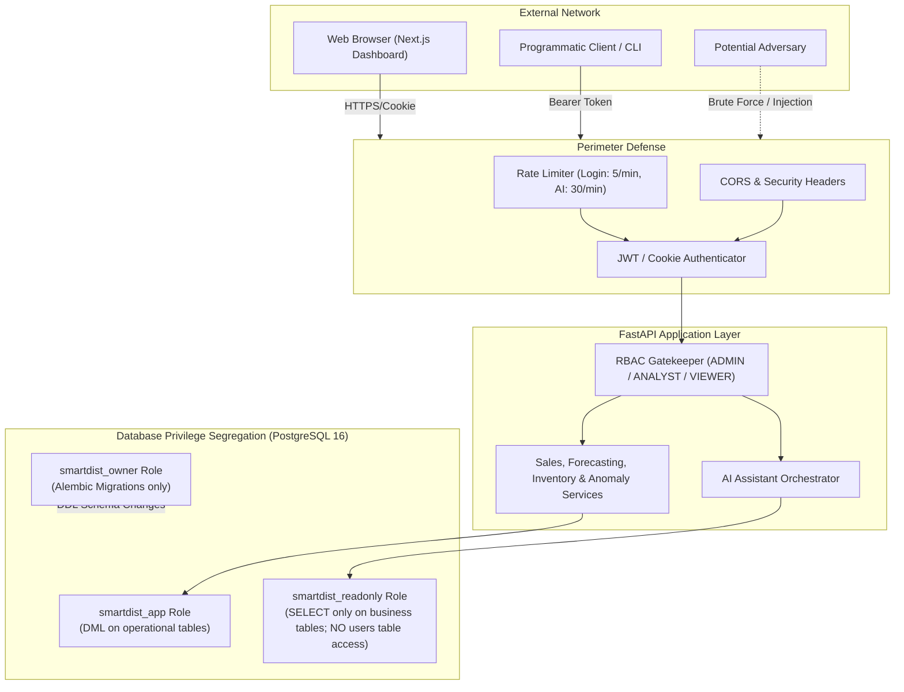
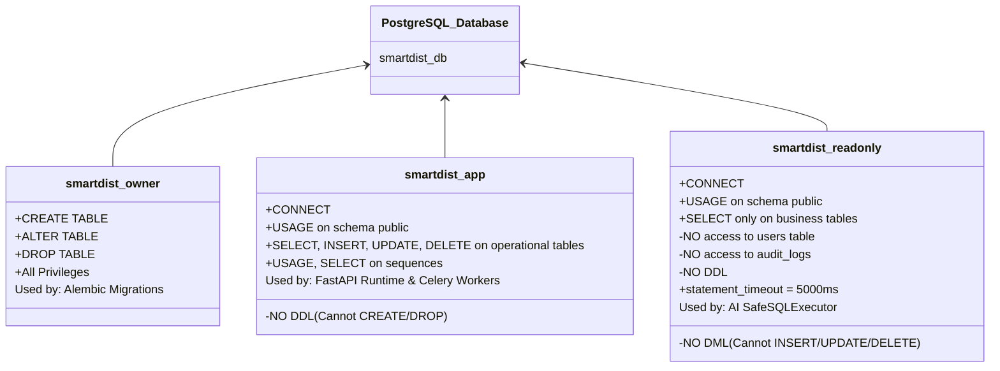
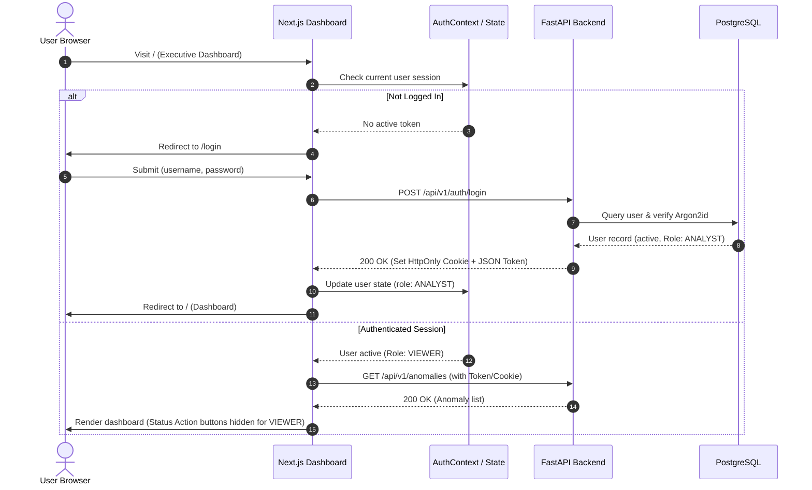

# SmartDist AI — Phase 5.1: Security Foundation Architecture & Design

> **Document Status**: Complete Architecture & Security Audit Design  
> **Milestone**: Phase 5.1 — Security Foundation  
> **Target Date**: November 2026  
> **Repository**: `~/Documents/smartdist-ai`  
> **Verdict of Baseline Test Run**: 189 of 189 backend tests passed in 124.05s | Frontend TypeScript: 0 errors | ESLint: 0 warnings | Next.js Build: 9/9 pages generated successfully.

---

## 1. Executive Summary & Audit Findings

SmartDist AI is an enterprise-grade distribution and retail intelligence platform that provides demand forecasting, inventory optimization, anomaly detection, and an AI Business Assistant. Phases 1 through 4 established a robust machine learning and business logic foundation. 

However, prior to Phase 5.1, the application operated under a **development trust model** without authentication boundaries, role segregation, or database privilege restrictions.

### 1.1 Fresh Baseline Verification
A fresh baseline verification was conducted immediately prior to this design:
- **Backend Test Suite**: `189 passed in 124.05s` (`pytest` across all Phase 1–4 modules, ETL, models, forecasters, backtesting, anomaly detectors, Text-to-SQL, and RAG).
- **Frontend Codebase**: `npx tsc --noEmit` produced 0 errors; `npm run lint` produced 0 warnings/errors; `npm run build` compiled 9 static/dynamic pages cleanly.
- **Git Status**: Working tree clean of accidental secrets, credentials, or untracked cache artifacts.

### 1.2 Security Controls Audit (Current vs. Required)

| Security Domain | Current State (Phase 4) | Vulnerability / Gap | Required State (Phase 5.1) |
|---|---|---|---|
| **API Authentication** | None (All endpoints open) | Anyone on the network can access forecasts, run expensive inventory optimization, trigger anomaly detection runs, or query the AI assistant. | JWT authentication with Argon2id password hashing, secure token delivery, and generic error responses. |
| **Role-Based Access Control (RBAC)** | None (Uniform public access) | No distinction between a C-level executive, a quantitative analyst, and a warehouse viewer. Any user could change anomaly statuses or execute AI workflows. | Three-tier RBAC (`ADMIN`, `ANALYST`, `VIEWER`) enforced on FastAPI endpoint dependencies. |
| **PostgreSQL Privileges** | Single schema owner (`smartdist_user`) used for migrations, REST API sessions, and SQL Assistant. | SQL execution is guarded by regex and session-level `SET LOCAL transaction_read_only = on`. If a bypass occurs, the attacker has full DDL/DML rights as schema owner. | Strict three-role separation: `smartdist_owner` (migrations only), `smartdist_app` (runtime DML), and `smartdist_readonly` (SELECT only on approved tables; no access to users or secrets). |
| **API Abuse & DoS Protection** | No rate limits; open exception traceback handling. | Vulnerable to credential brute-forcing on login and resource exhaustion on forecasting and AI assistant endpoints. | Rate limiting on authentication and assistant endpoints; sanitized error responses without DB/stack trace leakage. |
| **CORS & Network Boundaries** | Default development origins allowed. | Risk of cross-origin abuse if deployed to production without domain pinning. | Configurable environment-pinned CORS; credentialed access protection. |
| **Frontend Authentication State** | Dashboard pages open to unauthenticated viewers. | Any browser client can navigate to management dashboards. | `/login` page, reactive AuthContext, session expiry handling, and role-aware UI controls. |

---

## 2. Threat Model (STRIDE Assessment)



### 2.1 Threat Vectors & Mitigations

1. **Spoofing Identity**:
   - *Threat*: Adversary sends requests impersonating an executive or analyst.
   - *Mitigation*: Strong cryptographic password hashing using Argon2id (RFC 9106 parameters). Short-lived (15–30 min) signed JSON Web Tokens (JWT) verified with HMAC-SHA256 (`HS256`) and a minimum 256-bit environment-stored secret.
2. **Tampering with Data**:
   - *Threat*: A viewer or unauthorized actor updates an anomaly status to `FALSE_POSITIVE` to conceal supply chain discrepancies.
   - *Mitigation*: Server-side RBAC enforcement using FastAPI dependencies (`require_roles([Role.ADMIN, Role.ANALYST])`). Viewers receive HTTP 403 Forbidden.
3. **Repudiation**:
   - *Threat*: A user modifies operational data or triggers model retraining without an audit trail.
   - *Mitigation*: Security audit logging capturing the authenticated `user_id`, username, endpoint, and action.
4. **Information Disclosure (Credential / SQL Exfiltration)**:
   - *Threat*: Adversary crafts a natural language prompt or complex CTE designed to bypass regex validation and inspect `users` or password hashes.
   - *Mitigation*: Database-level isolation. The `smartdist_readonly` role used by the SQL Assistant has explicit `REVOKE ALL` on `users`, `audit_logs`, and system tables, and only `GRANT SELECT` on approved business catalog and metric tables.
5. **Denial of Service (DoS)**:
   - *Threat*: High-frequency password guessing or repeated multi-horizon LightGBM forecast requests degrading system performance.
   - *Mitigation*: In-memory/Redis rate limiting on `/auth/login` (5 requests/minute per IP) and `/assistant` (30 requests/minute per user), combined with a 5000ms PostgreSQL statement timeout.
6. **Elevation of Privilege**:
   - *Threat*: A standard analyst accesses user management endpoints or modifies system configuration.
   - *Mitigation*: Explicit route-level security guards requiring `Role.ADMIN`.

---

## 3. RBAC Architecture & Permission Matrix

### 3.1 Roles Definition

- **`ADMIN`**:
  - Full administrative access to the platform.
  - User lifecycle management (create, list, update role, activate/deactivate users).
  - System configuration and manual execution of ETL / anomaly pipelines.
  - Full access to all business dashboards, forecasts, and inventory optimization.
  - **No Unrestricted SQL Access**: ADMIN users do NOT have raw or unconstrained SQL execution privileges. All AI Assistant SQL queries—regardless of the requesting user's role—are subject to `SQLValidator` sanitization, table allowlists, and execution through the read-only, least-privileged database role.
- **`ANALYST`**:
  - Operational business analytics and planning access.
  - Read sales, branches, products, suppliers, and inventory metrics.
  - Generate demand forecasts and calculate inventory replenishment policies.
  - Triage and update sales anomalies (`INVESTIGATING`, `CONFIRMED`, `FALSE_POSITIVE`, `RESOLVED`).
  - Access AI Assistant, execute permitted Text-to-SQL queries, and trigger operational workflows.
  - Strictly no user administration or system configuration access.
- **`VIEWER`**:
  - Read-only dashboard access for operational visibility.
  - View executive overview, sales trends, inventory levels, and anomaly lists.
  - Cannot modify anomaly statuses (blocked on `PATCH /anomalies/{id}/status` -> HTTP 403 Forbidden).
  - Cannot execute unvalidated or custom SQL queries (blocked on `POST /assistant/sql` -> HTTP 403 Forbidden).
  - Cannot trigger operational workflows (`POST /assistant/workflow` -> HTTP 403 Forbidden).
  - Cannot access user administration.

### 3.2 Granular Endpoint Permission Matrix

| Endpoint Route | HTTP Method | Minimum Required Role | Description |
|---|---|---|---|
| `/health` | GET | **Public** | Root health check |
| `/api/v1/health` | GET | **Public** | Subsystem health check (DB, Redis, Celery) |
| `/api/v1/auth/login` | POST | **Public** (Rate-limited: 5/min) | Issue access token via username/password |
| `/api/v1/auth/me` | GET | **Authenticated** (Any active role) | Retrieve current user profile and role |
| `/api/v1/auth/logout` | POST | **Authenticated** | Revoke session / clear cookie |
| `/api/v1/users` | GET | `ADMIN` | List all system users |
| `/api/v1/users` | POST | `ADMIN` | Create a new user with assigned role |
| `/api/v1/users/{id}` | GET, PUT | `ADMIN` | View/update user details or role |
| `/api/v1/users/{id}/status` | PATCH | `ADMIN` | Activate or deactivate user account |
| `/api/v1/data/summary` | GET | `VIEWER` | Platform aggregate data summary |
| `/api/v1/sales/*` | GET | `VIEWER` | Sales records, trends, aggregations |
| `/api/v1/branches/*` | GET | `VIEWER` | Branch catalog and performance metrics |
| `/api/v1/products/*` | GET | `VIEWER` | Product catalog and category lists |
| `/api/v1/inventory/*` | GET | `VIEWER` | Stock levels and optimization summaries |
| `/api/v1/inventory/{p}/{b}/forecast` | GET | `ANALYST` | Compute/retrieve machine learning forecasts |
| `/api/v1/anomalies` | GET | `VIEWER` | List detected anomalies with filters |
| `/api/v1/anomalies/{id}/status` | PATCH | `ANALYST` | Update anomaly triage status and notes |
| `/api/v1/anomalies/detect` | POST | `ADMIN` | Trigger background anomaly detection task |
| `/api/v1/assistant/chat` | POST | `ANALYST` | AI Assistant natural language query & RAG |
| `/api/v1/assistant/workflow` | POST | `ANALYST` | Execute operational triage workflows |
| `/api/v1/assistant/sql` | POST | `ANALYST` | Execute validated read-only SQL queries |

---

## 4. PostgreSQL Least-Privilege Architecture



### 4.1 Role Segregation Specifications

1. **`smartdist_owner` (Migration / Schema Authority)**:
   - Dedicated role used exclusively during Alembic database migrations (`alembic upgrade head`).
   - Non-superuser authority: Created as `NOSUPERUSER CREATEDB` (or standard database owner). It owns `smartdist_db` and the `public` schema, but possesses no host OS or cluster-level superuser rights.
   - Sets `ALTER DEFAULT PRIVILEGES FOR ROLE smartdist_owner IN SCHEMA public GRANT SELECT, INSERT, UPDATE, DELETE ON TABLES TO smartdist_app;` and `ALTER DEFAULT PRIVILEGES FOR ROLE smartdist_owner IN SCHEMA public GRANT USAGE, SELECT ON SEQUENCES TO smartdist_app;`.
   - Connection string configured via `POSTGRES_MIGRATION_URL` (or fallback to existing `POSTGRES_USER` in local dev).
   - Never used for serving web API requests or AI Assistant queries.

2. **`smartdist_app` (Application Runtime)**:
   - Used by the FastAPI web application and Celery worker for daily operational transactions.
   - Non-owner role: Has no schema ownership, cannot issue `CREATE TABLE`, `DROP TABLE`, or `ALTER TABLE`.
   - Explicit grants:
     - `CONNECT ON DATABASE smartdist_db`
     - `USAGE ON SCHEMA public`
     - `SELECT, INSERT, UPDATE, DELETE ON ALL TABLES IN SCHEMA public`
     - `USAGE, SELECT ON ALL SEQUENCES IN SCHEMA public`

3. **`smartdist_readonly` (AI Assistant SQL Engine)**:
   - Dedicated connection pool utilized by `SafeSQLExecutor`.
   - Strict read-only boundaries:
     - `CONNECT ON DATABASE smartdist_db`
     - `USAGE ON SCHEMA public`
     - `SELECT` strictly on explicitly approved business entities:
       - `products` (id, sku, name, category_id, unit_price, cost_price, is_active, created_at, updated_at)
       - `categories` (id, name, code, description, created_at, updated_at)
       - `branches` (id, code, name, city, state, branch_type, is_active, created_at, updated_at)
       - `daily_sales` (id, sale_date, product_id, branch_id, quantity_sold, unit_price, total_amount, on_promotion, created_at)
       - `inventories` (id, product_id, branch_id, quantity_on_hand, quantity_reserved, quantity_available, min_stock_level, max_stock_level, reorder_point, created_at, updated_at)
       - `inventory_transactions` (id, inventory_id, transaction_type, quantity, reference_id, notes, transaction_date, created_at)
       - `sales_anomalies` (id, detection_run_id, anomaly_date, branch_id, product_id, observed_quantity, expected_quantity, deviation, anomaly_score, severity, direction, detector_evidence, explanation, recommended_actions, investigation_status, resolution_note, data_provenance, created_at, updated_at)
       - `anomaly_detection_runs` (id, run_timestamp, model_version, parameters, total_anomalies_detected, status, execution_time_seconds, created_at)
   - Explicit Denials & Revocations:
     - `REVOKE ALL ON TABLE users FROM smartdist_readonly;`
     - `REVOKE ALL ON TABLE data_import_logs FROM smartdist_readonly;`
     - `REVOKE ALL ON TABLE alembic_version FROM smartdist_readonly;`
     - No DDL (`CREATE`, `ALTER`, `DROP`), no DML (`INSERT`, `UPDATE`, `DELETE`, `TRUNCATE`).
     - Default timeout enforced at role level: `ALTER ROLE smartdist_readonly SET statement_timeout = '5000ms';`
     - Transaction mode enforced at role level: `ALTER ROLE smartdist_readonly SET default_transaction_read_only = on;`

### 4.2 Safe Database Provisioning Script (`scripts/provision_db_roles.sql`)
An idempotent SQL script using PostgreSQL procedural blocks (`DO $$ BEGIN ... END $$;`) creates the roles and grants without dropping existing data.

---

## 5. Authentication & Token Lifecycle Design

### 5.1 Password Hashing Strategy
- **Primary Algorithm**: `argon2-cffi` (Argon2id variant).
- **Parameters**:
  - Memory cost: 65,536 KiB (64 MiB)
  - Time cost: 3 iterations
  - Parallelism: 4 lanes
  - Hash length: 32 bytes
- **Fallback**: Cryptographically secure `bcrypt` (12 rounds) is supported seamlessly if argon2 binary bindings are unavailable in a restricted runtime.
- **Security Invariant**: Password hashes are never returned by any Pydantic schema or logged.

### 5.2 JWT Access Token & Revocation Specification
- **Algorithm**: HMAC-SHA256 (`HS256`).
- **Signing Key**: `SECRET_KEY` loaded strictly from environment variable (minimum 32 random characters / 256 bits). If in `production` and secret is default or missing, the application refuses to start.
- **Token Expiry**: Default 30 minutes (`ACCESS_TOKEN_EXPIRE_MINUTES = 30`).
- **Payload Claims**:
  ```json
  {
    "sub": "user_id_string",
    "username": "johndoe",
    "role": "ANALYST",
    "jti": "uuid4_unique_token_identifier",
    "iat": 1731153600,
    "exp": 1731155400
  }
  ```
- **Token Revocation & Logout (Defeating Stateless Token Window)**:
  - Acknowledging that stateless JWT access tokens remain cryptographically verifiable until their `exp` timestamp, the system implements an explicit **Revocation Blocklist**:
  - Upon calling `POST /api/v1/auth/logout`, the server extracts the token's `jti` (or SHA-256 hash of the token) and stores it in Redis under `token:blocklist:<jti>` with a TTL equal to the token's remaining lifetime.
  - The authentication dependency `get_current_user` checks Redis for `token:blocklist:<jti>`. If present, the token is rejected with HTTP 401 Unauthorized (`"Token has been revoked"`).
  - When refresh tokens are implemented, only their cryptographic SHA-256 hash is persisted in the database; refresh tokens are rotated on every use (old token invalidated immediately), and all user refresh tokens are revoked on password change or account deactivation.

### 5.3 Cookie, CORS & CSRF Security Specification
- **Dual Delivery Strategy**:
  1. `access_token` in JSON response for programmatic API / CLI consumers (`Authorization: Bearer <token>`).
  2. `access_token` set as a cookie for browser-based dashboard sessions.
- **Cookie Security Attributes**:
  - `HttpOnly`: True (prevents JavaScript access and mitigates XSS token exfiltration).
  - `SameSite`: `Lax` (defends against cross-site request forgery while permitting top-level navigation).
  - `Secure`: True when `ENVIRONMENT == "production"` or HTTPS is detected.
  - `Path`: `/`
  - `Max-Age`: Configured to match access token expiry (1800 seconds).
- **CSRF Defense**:
  - When requests rely on browser cookies, state-changing HTTP methods (`POST`, `PUT`, `PATCH`, `DELETE`) require custom header presence (`X-Requested-With: XMLHttpRequest` or `X-CSRF-Token`). Browsers do not allow cross-origin requests to set custom headers without prior CORS preflight approval.
  - CORS middleware is pinned to explicit origins from `CORS_ORIGINS`; wildcards (`*`) with credentials enabled are strictly rejected.

### 5.4 Login / Logout Flow & Anti-Enumeration
- **Login Request**: `POST /api/v1/auth/login` accepting JSON credentials (`username_or_email`, `password`).
- **Anti-Enumeration**: If the user is not found, account is disabled, or the password does not match, return identical response:
  - HTTP `401 Unauthorized`
  - Body: `{"detail": "Incorrect username or password"}`
- **Logout Request**: `POST /api/v1/auth/logout` places the access token onto the revocation blocklist, clears the authentication cookie, and returns HTTP 200.

---

## 6. API Protection & Rate Limiting Design

### 6.1 Distributed Redis Rate Limiting Architecture
To prevent credential stuffing, brute force attacks, and ML compute exhaustion across container replicas:
- **Rate Limit Tiers**:
  - `/api/v1/auth/login`: **5 requests per minute** per client IP.
  - `/api/v1/assistant/*`: **30 requests per minute** per authenticated user ID (or client IP).
  - General API endpoints: **120 requests per minute** per client.
- **Distributed Redis Implementation**:
  - Uses atomic Redis key operations (`INCR` with `EXPIRE` or sliding-window sorted sets) keyed by `ratelimit:<endpoint_scope>:<client_identifier>`.
  - Consistent across horizontally scaled FastAPI worker processes and containers.
- **Trusted Proxy Resolution**:
  - To prevent clients from bypassing IP rate limiting by forging `X-Forwarded-For`, client IP is extracted from `request.client.host` by default.
  - If a reverse proxy is configured (`TRUSTED_PROXIES`), only headers originating from those trusted CIDR blocks/IPs are parsed to determine the true upstream client IP.
- **Fail-Closed & Safe Fallback Policy**:
  - For sensitive authentication endpoints (`/api/v1/auth/login`), if Redis is temporarily unreachable, the rate limiter falls back to an in-memory thread-safe rate limiter. If memory allocation or tracking fails completely, the endpoint fails closed (returns HTTP 429 / 503) to prevent unmetered brute-force exploitation.
- **Response Format**: HTTP `429 Too Many Requests` with `Retry-After: <seconds>` header and descriptive JSON message.

### 6.2 Security Headers & CORS
- **CORS**: Reads `CORS_ORIGINS` from environment. In `production`, wildcard `*` is explicitly disallowed when `allow_credentials=True`.
- **Security Headers Middleware**: Injects:
  - `X-Content-Type-Options: nosniff`
  - `X-Frame-Options: DENY`
  - `X-XSS-Protection: 1; mode=block`
  - `Referrer-Policy: strict-origin-when-cross-origin`
  - `Content-Security-Policy: default-src 'self';` (adapted for Next.js assets).

### 6.3 Security-Conscious Logging
A custom logging filter ensures that any dictionary or query parameter containing `password`, `token`, `secret`, `authorization`, `cookie`, or `key` is masked before emission to application logs.

---

## 7. Frontend Integration Design

### 7.1 Architecture & Flow



### 7.2 Frontend Implementation Components
1. **Login Page (`frontend/src/app/login/page.tsx`)**:
   - Modern, clean login card styled with Tailwind CSS consistent with the enterprise UI.
   - Form fields: Username or Email, Password.
   - Loading states, generic error display ("Invalid username or password"), and autofocus.
2. **Auth Context & Hook (`frontend/src/context/AuthContext.tsx`)**:
   - Manages `user` state (`username`, `email`, `role`, `isAuthenticated`).
   - Initial hydration via `GET /api/v1/auth/me`.
   - Methods: `login(username, password)`, `logout()`.
3. **API Client Integration (`frontend/src/lib/api.ts`)**:
   - Updates `fetch` calls to include `credentials: "include"` (for HttpOnly cookies) and `Authorization: Bearer <token>` when available.
   - Interceptor: On HTTP `401 Unauthorized`, clears local state and routes to `/login`.
4. **Role-Aware UI Adaptation**:
   - **Header**: Displays user avatar, username, and role badge (`ADMIN` in purple, `ANALYST` in blue, `VIEWER` in gray), plus a Logout icon button.
   - **Anomalies Page**: The status update dropdown and transition buttons are disabled/hidden when `user.role === 'VIEWER'`.
   - **Assistant Page**: Shows a read-only advisory if a viewer attempts to run custom SQL or automated triage workflows.

---

## 8. Migration Strategy & Compatibility Assurance

### 8.1 Zero-Downtime Migration & Database Role Enforcement
1. **Alembic Revision (`004_create_users_table.py`)**:
   - Executes strictly under the `smartdist_owner` connection (`POSTGRES_MIGRATION_URL`).
   - Creates the `users` table with unique indexes on `username` and `email` without altering existing business tables or model weights.
   - Applies default privileges so runtime role `smartdist_app` is granted appropriate DML.
2. **Runtime Least-Privilege Separation**:
   - Application runtime connections (`DATABASE_URL` / `POSTGRES_USER`) connect as `smartdist_app` (or configured runtime user). They never connect as schema owner.
   - SQL Assistant connects through `POSTGRES_READONLY_URL` as `smartdist_readonly`, completely quarantined from `users` and administrative tables.
3. **Database Provisioning (`scripts/provision_db_roles.sql`)**:
   - Safe, non-destructive SQL script utilizing `DO $$ BEGIN ... END $$;` blocks.
   - Creates non-superuser roles and applies table and column grants idempotently.
4. **Initial Admin Seed**:
   - Seed script / startup hook (`backend/app/db/init_db.py`): if no users exist in the `users` table, seeds a default administrator account:
     - Username: `admin`
     - Email: `admin@smartdist.ai`
     - Role: `ADMIN`
     - Password: Set securely from `INITIAL_ADMIN_PASSWORD` (default: `Admin@SmartDist2026!`).
5. **Testing Isolation & Backward Compatibility**:
   - Existing 189 backend tests remain completely functional by utilizing isolated test dependencies and session overrides.
   - New security tests rigorously verify authentication, RBAC boundaries, token revocation, rate limiting, and database least-privilege denial rules.

---

## 9. Implementation Plan & File Modification Breakdown

### Files to Create:
- [`backend/app/models/user.py`](../../backend/app/models/user.py): SQLAlchemy `User` model with `RoleEnum`.
- [`backend/app/schemas/user.py`](../../backend/app/schemas/user.py): Pydantic schemas (`UserCreate`, `UserUpdate`, `UserResponse`, `TokenResponse`, `LoginRequest`).
- [`backend/app/core/security.py`](../../backend/app/core/security.py): Password hashing (Argon2id/bcrypt), JWT creation, and verification.
- [`backend/app/core/rate_limit.py`](../../backend/app/core/rate_limit.py): In-memory/Redis rate limiting middleware.
- [`backend/app/api/deps.py`](../../backend/app/api/deps.py): FastAPI security dependencies (`get_current_user`, `get_current_active_user`, `require_roles`).
- [`backend/app/api/v1/endpoints/auth.py`](../../backend/app/api/v1/endpoints/auth.py): Authentication router (`/login`, `/me`, `/logout`).
- [`backend/app/api/v1/endpoints/users.py`](../../backend/app/api/v1/endpoints/users.py): User management router (`ADMIN` only).
- [`backend/alembic/versions/20261109_1930_51a2b3c4d5e6_create_users_table.py`](../../backend/alembic/versions/20261109_1930_51a2b3c4d5e6_create_users_table.py): Alembic migration for users.
- [`scripts/provision_db_roles.sql`](../../scripts/provision_db_roles.sql): Idempotent SQL script for PostgreSQL least-privilege role separation.
- [`frontend/src/app/login/page.tsx`](../../frontend/src/app/login/page.tsx): Next.js login screen.
- [`frontend/src/context/AuthContext.tsx`](../../frontend/src/context/AuthContext.tsx): React authentication state provider.
- [`backend/tests/test_auth.py`](../../backend/tests/test_auth.py): Test suite covering authentication, token expiry, invalid credentials, and password hashing.
- [`backend/tests/test_rbac.py`](../../backend/tests/test_rbac.py): Test suite covering role permissions (`ADMIN`, `ANALYST`, `VIEWER`), forbidden actions, and unauthenticated requests.
- [`backend/tests/test_db_least_privilege.py`](../../backend/tests/test_db_least_privilege.py): Test suite verifying database role separation and read-only executor boundaries.
- Documentation deliverables:
  - [`docs/phase5/authentication-and-rbac.md`](../phase5/authentication-and-rbac.md)
  - [`docs/phase5/database-security.md`](../phase5/database-security.md)
  - [`docs/phase5/security-configuration.md`](../phase5/security-configuration.md)

### Files to Modify:
- [`backend/requirements.txt`](../../backend/requirements.txt): Add `argon2-cffi` and `pyjwt`.
- [`backend/app/core/config.py`](../../backend/app/core/config.py): Add `SECRET_KEY`, `ACCESS_TOKEN_EXPIRE_MINUTES`, `POSTGRES_READONLY_URL`, `POSTGRES_MIGRATION_URL`.
- [`backend/app/db/session.py`](../../backend/app/db/session.py): Add read-only engine/sessionmaker for least-privilege executor.
- [`ai_assistant/sql_agent/sql_executor.py`](../../ai_assistant/sql_agent/sql_executor.py): Connect via dedicated read-only session.
- [`backend/app/api/v1/router.py`](../../backend/app/api/v1/router.py): Mount `/auth` and `/users` routers; attach security dependencies to protected sub-routers.
- [`backend/app/main.py`](../../backend/app/main.py): Register security headers middleware and rate-limiting exception handler.
- [`frontend/src/lib/api.ts`](../../frontend/src/lib/api.ts): Add auth endpoints (`login`, `me`, `logout`) and credentials forwarding.
- [`frontend/src/components/Header.tsx`](../../frontend/src/components/Header.tsx): Display active user badge and logout button.
- [`frontend/src/app/layout.tsx`](../../frontend/src/app/layout.tsx): Wrap application inside `AuthProvider`.

---

## 10. Verification & Quality Gates

1. **Step 1 Baseline (Completed)**: 189 tests passing, 0 lint warnings, Next.js build clean.
2. **Security Test Coverage**:
   - Unit tests for Argon2id hashing and verification.
   - JWT creation, decoding, tamper detection, and expiration.
   - Endpoint RBAC tests: verify 401 on unauthenticated, 403 on forbidden role, and 200 on authorized role.
   - SQL Executor least-privilege test: verify `smartdist_readonly` cannot query `users` or execute DDL/DML.
3. **Regression Guarantee**:
   - All existing 189 backend tests must continue to pass seamlessly (`pytest -v`).
   - Frontend build must compile cleanly without TypeScript or ESLint errors (`npm run build`).

